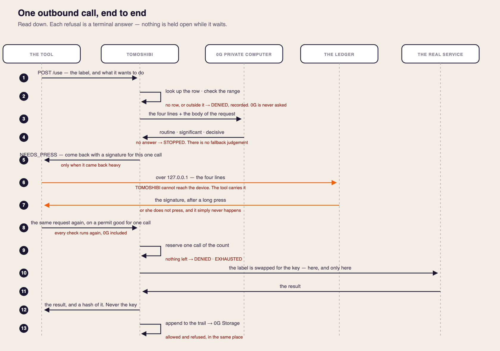

# TOMOSHIBI 🕯️

**A review score never expires. A flame goes out. That is the whole idea.**

> ### Your agent is holding a spare key that works until you cancel it.
>
> **For anyone who hands an AI agent a real key** — a Stripe secret, a wallet, a logged-in session —
> **TOMOSHIBI is the approval layer that hands over one use instead of the key.**
> It does for every action an agent takes what your bank does for a single card payment:
> you approve this one, not all future ones.
> **Unlike a password manager, the secret is never handed over at all** — and every refusal is
> kept, named and signed.

AI agents are starting to ask for our API keys the way apps once asked for passwords — a secret
with no scope, no expiry and no receipt, handed to code we did not read. **TOMOSHIBI puts one
button in front of the key that an AI cannot press.** You sign a scope on a Ledger device — which
key, which destination, which operation, how many times, until when — and the four lines on the
device screen are built from the same bytes that get signed. The skill never receives the secret.
Anything outside the signed scope is refused *before* it happens, and recorded with the skill's own
signature on the request.

And a star is not a review. A star means *I, a verified human, am using this version with my own
key.* **When the version changes, every star goes out at once.**

## Try it now

| | |
|---|---|
| **Start here — lend a key, get woken, read the morning after** | **https://mintannn.github.io/tomoshibi/start.html** |
| The gate — four different ways to stop | https://kou-uni.github.io/ethglobal-mumbai/web/gate.html |
| The flame — stars go out when the version changes | https://kou-uni.github.io/ethglobal-mumbai/ui/stars.html |
| **The business model, the lean canvas and three years of cash** | https://kou-uni.github.io/ethglobal-mumbai/ideation/2026-11-06-business-model.html |
| The market, the model and what we will not do | https://kou-uni.github.io/ethglobal-mumbai/ideation/2026-11-06-market-and-model.html |

```bash
git clone https://github.com/kou-uni/ethglobal-mumbai && cd ethglobal-mumbai/broker
npm i && npm test                 # 60 / 60
PORT=8797 EXECUTE=0 node src/server.js   # needs ZG_API_KEY, ZG_PRIVATE_KEY
node demo.mjs http://127.0.0.1:8797      # all five paths, end to end
```

> **Who this is for, what it stops, and what it assumes — stated plainly:** [`POSITION.md`](POSITION.md)

## What it is: NAT, for API keys


A home router does not give your laptop the public address. It gives it a private one, and
swaps the two at the edge. TOMOSHIBI does that with credentials. A tool is given a **label**
— `stripe-live`, `gh-readonly`. The real key stays in one table inside the laptop, with the
range it may be used in beside it. The swap happens at the moment of sending, nowhere else,
and the Ledger in your hand is the only thing that can add a row to that table or approve a
heavy crossing.

It is for the person running a dozen keys across their own tools and other people's — today
scattered across `.env` files, chat history and CI secrets, with no way to say what used
which.

## One request, end to end



Putting a key into the table and signing the range it may be used in happens **once per key**.
Everything numbered here is a **single request**: it starts where the tool asks with a label,
and the Ledger appears only when the weighing came back heavy — and even then TOMOSHIBI
answers the tool, which reaches the device over 127.0.0.1. TOMOSHIBI cannot. Beside each step
is what that step refuses, so the picture shows where a request dies as well as where it goes.

Both figures are generated from one bilingual source, [`assets/build-figures.py`](assets/build-figures.py),
so the two languages cannot drift apart. The figures, this page and the deck are all written
from one place: **[`docs/HOW-IT-RUNS.md`](docs/HOW-IT-RUNS.md)** — the processes, the state and
the sequence, read off the code. If anything here disagrees with that page, that page is right.

## What it does, in four parts

Everything in this repository is one of four things. The rest is support.

| | What it does | What it means for the person whose key it is |
|---|---|---|
| **1. Custody** | The secret stays with the Broker. The agent is given a handle; the real credential is put in at the moment of sending, and only for a destination and an operation a human signed. | **You never hand the key over. You hand over one use of it.** |
| **2. Weight and press** | Before anything runs, a sealed model reads the request and says how much it matters. Routine goes through. Anything heavier waits until a person holds the button on a hardware device. | **Nothing asks you on an ordinary day, and money cannot move while you are asleep.** |
| **3. Trail and attribution** | Every request, allowed or refused, is appended with its reason, and a request made outside the signed scope is recorded carrying the skill's own signature. | **After an incident you can say what was stopped, and whose code tried it.** |
| **4. Flame** | A star can be lit only by the person who owned the key and actually used that version, confirmed once through World ID. Every star goes out when the version changes. | **You choose by whose star it is, not by how many.** |

**Supporting, not headline:** sealing the trail into 0G Storage, the USB bridge to the Ledger,
skill-signature verification, the morning summary and the per-request trace.

**What it assumes.** The Broker is meant to run somewhere the agent is not. On a laptop where the
agent has a shell, that agent can read the Broker's environment — custody is the one of the four
that needs the Broker hosted, and in time inside a confidential VM. The other three hold either
way, because they rest on a signature made on a device the agent cannot reach.

## The four ways it stops

They are never collapsed into one "error".

| | What it means | Whose decision |
|---|---|---|
| `DENIED` | Outside the scope the human signed | **The human drew that line** |
| `NEEDS_PRESS` | Irreversible, and nobody has pressed yet | Waiting on a person |
| `STOPPED` | Our sealed judge was unreachable, so **no verdict exists** | **Ours — and we do not bill for it** |
| `human_denied` / `proof_expired` | A person said no, or the permit ran out | The permit |

The refusal is the product. An agent that cannot say *which* kind of no is an agent you cannot
leave alone.

## What each sponsor's technology does here

| | In one sentence | The exact line |
|---|---|---|
| **0G** Private Computer | Before a request runs, a TEE-attested model reads the body and says how heavy the action is. The Broker passes the body through and **keeps none of it** — not in the trail, not in a log — and **the operator of the model cannot read it**. The Broker itself is not yet inside a TEE; we say so below rather than claim more. 467 calls, 2.0 s, $0.000036 each; the trail is sealed on Galileo. | [`broker/src/weigh.js#L68`](https://github.com/kou-uni/ethglobal-mumbai/blob/99e91a1ef6a684eb1d2854ba5388ff41ee5269a9/broker/src/weigh.js#L68) |
| **World** Agent Pass | A star can only be lit by a verified human — one pseudonym, one star, per version — so a signal that sells for $0.0027 today cannot be bought here. OIDC `device_code`, called from a Broker with **no screen**; we bind only the `sub`. | [`broker/src/world.js#L39`](https://github.com/kou-uni/ethglobal-mumbai/blob/99e91a1ef6a684eb1d2854ba5388ff41ee5269a9/broker/src/world.js#L39) |
| **Ethereum Foundation** CROPS | The public trail carries **no request body and no key** — only a hash of what came back. **The signing key never leaves the Ledger**, which builds the EIP-712 digest from the same four lines it shows you; **the API key never leaves the Broker and is never handed to the agent.** | [`broker/src/execute.js#L21`](https://github.com/kou-uni/ethglobal-mumbai/blob/99e91a1ef6a684eb1d2854ba5388ff41ee5269a9/broker/src/execute.js#L21) |

**What we did not finish, said here rather than buried:** the Broker is the single point of trust and
is **not** in a TEE this time, and the anonymous read path for stars is designed but not built.

## Where to look, by how long you have

| You have | Open |
|---|---|
| **30 seconds** | The two tables above, then the demo: **https://mintannn.github.io/tomoshibi/start.html** |
| **5 minutes** | `ideation/2026-11-06-decisions.md` (numbered decisions, each with what we rejected) · `LEAN-CANVAS.md` · [the figures, drawn](https://kou-uni.github.io/ethglobal-mumbai/ideation/2026-11-06-business-model.html) |
| **30 minutes** | `spec/permit-signature.md` (the frozen domain, with a cross-side test vector) · `broker/src/weigh.js`, `world.js`, `execute.js` · `broker/test` — **60 tests**, including 100 concurrent requests against a budget of 3 |
| **You are looking for one thing** | Every directory has a `README.md` saying what is in it. `ideation/README.md` indexes all 47 working documents by purpose |

## Verifiable facts

| | |
|---|---|
| A trail sealed on **0G mainnet-testnet (Galileo, chainId 16602)** | tx [`0x74c7cdf9…aef1`](https://chainscan-galileo.0g.ai/tx/0x74c7cdf9bca055c502918e62a7ac9fc7634d1326471433ab10161045aa97aef1) · block **64103318** · `status 0x1` |
| 0G Storage root hash | `0xc0e0c7a911547490680d545ad9d4638a9bf23bd72d8a3004edf9b4ffaa5be080` |
| Tests | **60 / 60**, including the frozen cross-side signature vector (`spec/permit-signature.md` §6) |
| Measured against the **real** 0G Private Computer (TeeML, TDX-attested) | **467 calls** · 2.0 s per verdict · **$0.000036** per verdict |
| Hardware | A custom **Ledger** app in Rust. No blind signing: the host never sends a digest |

## What was hard

1. **The screen and the signature cannot disagree.** The EIP-712 digest is computed *inside* the
   device from the same four values it displays. The host never sends a digest, so blind signing is
   structurally impossible — not merely discouraged.
2. **The count holds under concurrency.** The call budget is reserved before execution with no
   `await` between the check and the record. 100 simultaneous requests against `maxCalls=3` let
   through 0 extra — covered by a test.
3. **Refusing to invent a verdict.** If the sealed model is unreachable we return `STOPPED` and
   change nothing — no default, no rule-based stand-in. **A fabricated verdict is worse than no
   verdict.** Four stops are kept apart because a different stop means a different responsibility:
   `DENIED` (you drew that line in advance) · `STOPPED` (nobody could decide) ·
   `NEEDS_PRESS` (irreversible, and no human has pressed yet) · `human_denied` / `proof_expired`.

## Why this is not the thing next to it

Secrets managers decide *where a key lives*. Certificate systems decide *which machine it is*.
Agent payment rails decide *that it can pay* — and have no reason to stop anything, since volume is
their revenue. **None of them decide whether this one request, right now, was allowed by a human —
and none of them keep the refusals.**

## Why India picked this problem before we did

From **April 2026** the RBI requires a *dynamic, per-transaction* authentication factor for
card-not-present payments, and it applies whether a human or an agent initiates it. NPCI is building
agent payments on UPI with spending limits, audit trails, identity checks and a liability framework.
And CERT-In's Digital Threat Report 2025-26 asks to *"mandate human-in-the-loop controls for agentic
AI actions above defined financial thresholds, with full audit trails."*

**That last sentence is our product description.** We have not integrated with UPI and do not claim
to — the match is structural, and that is the claim. Sources and the honest limits:
[`ideation/2026-11-06-why-mumbai.md`](ideation/2026-11-06-why-mumbai.md).

---

> Start at [START-HERE.md](START-HERE.md) for the current state, how to run it, and what is next.
> ETHGlobal Mumbai 2026 (kou-uni × mintannn). Hacking window: 11/5 21:00 → 11/7 09:00 IST.

**TOMOSHIBI** (*tomoshibi* / a small flame that can go out) —
**Keep the one place an AI cannot see on your own device, and let the AI carry only who trusted what.**
Not how many stars. Whose star.

## Design and decision records

| Where | What |
|---|---|
| `ideation/2026-11-06-decisions.md` | **The decision record.** What we decided (most recent) |
| **`ideation/2026-11-07-finalist-4min.md`** | **Script for the 7-minute finalist round.** Run sheet for the 4-minute demo, the order we cut things if we are pressed, 3 minutes of Q&A (the 3 usual questions plus the 6 hard ones we know are coming) |
| **`ideation/2026-11-06-submission-rules.md`** | **Submission and judging rules (official ETHGlobal).** Deadlines, what is not allowed, judging criteria, video rules, and where we stand against each |
| **`ideation/2026-11-06-stack.html`** | **The system stack.** Seven layers (protocol / tooling / product) and what happens when a borrowed piece goes down |
| `ideation/2026-11-06-minta-proposal.md` | minta's proposal: make a star a fact, not a promise (adopted) |
| **`ui/`** | **Working demo screens (prototype).** `index.html` = the gate (all four ways to stop are visible) / `stars.html` = the flame (goes out when the version rises). The values are real responses from live 0G |
| **`ideation/2026-11-06-market-and-model.html`** | **Market size (TAM/SAM/SOM) and business model.** TAM $43B · SAM $2–7B · SOM $1.4M (year three) / three revenue lines and the cost of one verdict (measured: $0.000036) / what we will not do |
| **`ideation/2026-11-06-diagrams.html`** | **Architecture diagram and five sequence diagrams.** Let it through / make them press / stop it / decline to decide / light a flame (generated by `ideation/build-diagrams.py`) |
| `ideation/2026-11-06-touchpoints.html` | **Who meets which screen, when, and what it changes for them.** Breakdown of the nine open decisions, and which of them Stack-chan would touch |
| `ideation/2026-11-06-screen-flow.html` | **Screen flow and process.** Five screens · transition table · the usage flow · the World flow · three open decisions |
| `ideation/2026-11-06-demo-scenario.md` | **The demo storyline.** 3-minute run sheet · 90-second cut · the fallback when something breaks · the checks before we record |
| `ideation/2026-11-06-storyboard.md` | **The demo script.** Three screens · a 3-minute storyboard · the five shots that land · taglines ([view on phone](https://htmlpreview.github.io/?https://github.com/kou-uni/ethglobal-mumbai/blob/main/ideation/2026-11-06-storyboard.html)) |
| `ideation/2026-11-06-final-image.md` | **The finished picture.** Architecture diagram · business model · personas · journey (storyboard for the video) |
| `ideation/2026-11-06-philosophy.md` | **Philosophy.** Why we are building this (features can be cut; this cannot) |
| `ideation/2026-11-06-review.md` | **Read this first.** The story and the features on one page (marked agreed / proposed) |
| `ideation/2026-11-06-integrated.md` | The merged discussion |
| `ideation/2026-11-06-architecture.md` | Architecture (draft v2) |
| `ideation/2026-11-06-architecture-v2.html` | Diagram (download it and open it in a browser) |
| `research/10-ef-fit.md` | Fit with the EF prizes (CROPS > Anon-RPC) |

## Where this is now, and where it goes

**Working today, end to end.** A request from an agent is checked against a permit signed on a
Ledger, weighed by a sealed model on 0G, executed through a proxy that never hands the secret over,
and written to an append-only trail sealed on 0G Storage. A flame can be lit only by a
World-verified human who actually holds the key and has actually used it. 60 tests, including 100
concurrent requests against a budget of 3, and a cross-side signature vector that both the device
and the Broker must agree on.

| When | What |
|---|---|
| **Now** | Permits on a Ledger · scope, destination, operation, call budget and expiry enforced · four distinct refusals · sealed weighing in the decision loop · public trail · flames that die on a version bump |
| **Next** | **The Broker inside a TEE**, so the one remaining point of trust goes away · **anonymous star reads**, so looking up a skill does not say which skill you care about · revoking a flame · proxied execution against real APIs beyond the demo's `EXECUTE=0` |
| **After that** | A permit format other wallets and devices can implement — the four lines are not Ledger-specific · a public register of refusals, so a skill's violations follow it across installs · the same gate in front of an x402 wallet |

**The shape we are heading for:** a human signs scope, a machine enforces it, and everything that
was refused stays legible to the person who drew the line. Nothing above requires a token or a new
chain to work.

## Reference, if you want the working documents


| Where | What |
|---|---|
| `ideation/2026-11-06-plan.md` | **How we work and the timetable.** Who does what · the checkpoints · what we drop |
| `ideation/2026-11-06-tech-value-review.md` | **Where World / Ledger / 0G each sit, and a re-check of whether they are really in the build** |
| `research/11-prize-gap.md` | **Per prize: can we win it, what is missing, how to close the gap** (ceiling $11,250) |
| **`broker/`** | **The working thing.** `use` → scope check → **0G decides the weight** → proxied execution → trail, plus **lighting a star with World**. `npm test` 60 tests / `node demo.mjs` |
| `ideation/2026-11-06-world-integration-notes.md` | **Retrospective on the World integration** (required for both World prizes; §6 is the English text for the submission) |
| `spec/permit-signature.md` | **The signing contract.** Derivation path · EIP-712 · how the Broker verifies. The boundary between Ledger and Broker |
| `spec/world-agent-pass.md` | **What World Agent Pass actually is, and how to wire it in** (OIDC / device flow) |

**Split of work (#12): minta owns everything people see, kou owns everything they do not.**
The boundary is one JSON in `spec/permit-signature.md` and the Broker's HTTP.


## Privacy (EF CROPS)

**Who knows what. The design keeps them apart.**

| | Knows | Does not know |
|---|---|---|
| **Ledger (the device)** | The four lines of scope (key label, destination, operation, expiry), and whether it was pressed | The body of the request. The key never leaves in the clear either |
| **World** | **That this is a human, and the same human** (a per-sector pseudonym) | Which skill got a star · which key · when it was used |
| **0G Private Computer (TeeML)** | The body of the request (**inside the seal**, to decide the weight) | Either key. **Its operator cannot read the body** — the inference runs inside the TEE |
| **Broker** | Scope · verdicts · the trail | — **This is the one point of trust, and we did not put it in a TEE this time**. We say so rather than let it pass unnoticed |
| **The trail (0G Storage)** | Who permitted it, what was requested, and whether it went through or stopped | **No body, no key.** It is written to be public |

- **A star binds to a pseudonym and nothing else.** We seal only the World `sub` (per sector). No name, no email, no wallet
- **No trackers.** No analytics scripts, no pixels, no third-party cookies
- **Open source.** MIT (`LICENSE`). Dependencies are `viem` / `jose` / `ethers` / `@0gfoundation/0g-storage-ts-sdk`
- **Lookups must not leak.** Star reads go through Anon-RPC by default: fetch everything, filter on the device
  (**not implemented.** `research/10-ef-fit.md`, decision #6)

## Why these three, and what each one gets back

Three sponsor technologies are load-bearing here. For each: what breaks without it, and — because
a hackathon integration that only takes is not worth much to the sponsor — what using it this way
demonstrates for them.

### 0G Private Computer

**Without it, there is no product.** Deciding how heavy an action is requires reading the request.
Reading the request is exactly what the operator of an approval layer must never do. Sealed
inference is the only thing that resolves that, and it has to sit *in the decision loop* — a model
that writes an opinion into a log after the fact changes nothing.

**What it gets back:** most TEE inference demos are a chatbot with a badge, where the seal is
decorative because nothing would change if you removed it. Here the seal is **the reason the
feature can exist at all**, and the cost of being right about that is on record: 467 calls, 2.0 s
per verdict, **$0.000036 each**, with the trail sealed on 0G Storage. It is a worked argument that
privacy-preserving inference is cheap enough to put on the critical path of an ordinary product —
and a rare measurement of what it actually costs per decision. We also return `STOPPED` and bill
nothing when 0G is unreachable, which is the honest version of depending on someone else's service.

### World

**Without it, the flame is worth nothing.** A trust signal that money can buy is noise, and stars
sell for $0.0027 apiece today. The signal only means something if one verified human can light at
most one flame per version — and that requires personhood, not another account.

**What it gets back:** Agent Pass used the way it was meant to be used, from a **daemon with no
screen**, through the OIDC `device_code` grant. We bind the sector-scoped `sub` and nothing else,
so World learns no name, no e-mail, no wallet, and never learns which skill was endorsed or when.
It is a concrete answer to "what is proof of personhood actually *for* in the agent era": not
airdrop defence, but **making a reputation that cannot be purchased**. The integration notes,
including the hour lost to `device_authorization` returning 400 without `client_secret`, are in
`ideation/2026-11-06-world-integration-notes.md`.

### Ethereum Foundation (CROPS)

**Without this constraint, we would have built something worse.** The easy version of this product
reads every request in the clear and keeps a tidy log of it — and becomes the most attractive
database in its customers' infrastructure. Designing for minimum disclosure is what pushed the
reader inside a TEE and kept the trail to hashes.

**What it gets back:** a case study of the hard version of the problem — **a third party that must
read a payload in order to decide about it**, which is where "just don't collect it" stops being an
answer. We also publish the part we did not solve: the Broker is not yet in a TEE, and anonymous
star reads are designed but unbuilt. A privacy track is better served by an honest map of what is
still open than by a claim nobody checked.

### Why people come back tomorrow

One star means nothing. **The weight grows as the fact of still using it, with the same key, piles
up.** And every star goes out at once when the version changes, so **only the people still using it
notice, and light one again.**

## What we concentrated on, criterion by criterion

The judging criteria are **Technicality, Originality, Practicality, Usability and WOW**. They pull
in different directions, so this section says where we deliberately spent effort for each one, and
where we would expect to lose points.

### Technicality — *the hard part is not the proxy*

Anything can forward a request with a secret attached. Two things here are not easy, and both are
where the work went:

1. **The four lines a person reads and the bytes that get signed are the same object.** The EIP-712
   digest is computed **inside** the Ledger from the same four fields rendered on its screen; the
   host never sends a digest for signing. A host that lies about what it is asking for cannot
   produce a signature that verifies — `broker/src/permit.js`, `spec/permit-signature.md`
2. **A refusal carries the signature of whoever asked.** An out-of-scope request is recorded with
   the skill's own signature over the request hash, so attribution is not our assertion about who
   did it — `broker/src/skill.js`, `broker/src/scope.js`

And a third that is easy to get wrong: **the sealed model's silence is not a default.** If 0G cannot
be reached, the request is neither passed nor refused — `STOPPED` means no verdict exists, the call
budget is untouched, and we do not bill for it.

### Originality — *a stop that is an output, not a failure*

Most systems collapse everything that did not happen into one word: error. **We keep four, and never
merge them** — `DENIED`, `NEEDS_PRESS`, `STOPPED`, `human_denied`/`proof_expired`. An agent that
cannot say *which* kind of no is an agent you cannot leave alone, and the distinction is what makes
the trail readable by a person rather than by a developer.

The second original piece is **a reputation that can go out.** A star requires a World ID-verified
human **who actually used that exact version** — signing alone returns `NOT_USED` — and when the
version changes, every star on it is extinguished at once. Reputation that survives the thing it
was about is the failure mode of every review score we have.

### Practicality — *measured, not asserted*

It runs against live 0G and a real device, and the numbers are ours rather than a vendor's: **467
verdicts, 2.0 s each, $0.000036 a call**, with the trail sealed on Galileo. The pricing follows
from that: **metered judgement, no percentage of the money that moved** — so we are never a company
whose revenue falls when it stops more things. The first users are people who have already handed a
key to an agent; the first payer is a marketplace that has to answer for a stray skill.

### Usability — *a non-engineer has to be able to read it*

Three decisions were made against our own convenience:

- **Four lines, and only four,** on the device — key label, destination, operation, expiry. Not a
  JSON blob, not a hash
- **The morning page speaks in her words**, not HTTP: *"A refund"*, *"Read the balance"*, *"1 thing
  was stopped"* — `web/morning.js`
- **On an ordinary day it asks nothing.** A tool that interrupts every call gets switched off, and a
  switched-off tool protects no one. That is the whole reason the weighing step exists

### WOW — *one moment, in the hand*

**Bumping the version and watching every star go out at once.** It is the one thing in the demo that
is felt before it is explained. Second to it: the e-paper physically inverting black and white in
your hand when something is refused — a software animation cannot be mistaken for it.

### Where we expect to lose points, and why we are saying so

The Broker is **not yet inside a confidential VM**, so on a machine where the agent has a shell it
can read the Broker's environment. That is the one property of the four that needs hosting, it is
the first item under *Next* above, and `POSITION.md` §5 states it as a condition rather than hiding
it. We would rather be marked down for the gap than be found to have papered over it.

## How we built it (disclosure per the ETHGlobal rules)

**Built inside the hacking window (from 11/5 21:00 IST).** No pre-existing project-specific code.

### What we reused (public starter kits and libraries)

| Where | Origin | License |
|---|---|---|
| `ledger-app/` | Started from LedgerHQ **`app-boilerplate-rust`** (the app itself was written here) | Apache-2.0 |
| `broker/` dependencies | `viem` / `jose` / `ethers` / `@0gfoundation/0g-storage-ts-sdk` | Respective OSS licenses |
| `bridge/bridge.py` | `hidapi` (Python) | Respective OSS licenses |

Everything else (`broker/src/`, `web/`, `ui/`, `spec/`, `ideation/`) **was written here**.

### How we used AI tools

**We used Claude Code (Anthropic). Of the two of us, it was used on the side people do not see: the implementation and the documents.**

| Scope | How |
|---|---|
| `broker/src/`, `broker/test/` | **A human decided the design, the AI wrote it, a human verified it with tests.** The boundaries of the verdict (the four ways to stop, scope matching, the call budget) were written by a human as a spec first (`spec/`) |
| `ideation/`, `research/` | Used to draft the structure and the prose. **Only numbers, verdicts and measurements a human ran and confirmed are on the page** (marked [verified]) |
| `web/`, `ui/` | **Designed and built by minta** (the screens are human work) |
| `ledger-app/` (Rust) | **Built by minta on real hardware** (with AI assistance) |

**Everything the spec-driven work produced is in this repository:**
`spec/permit-signature.md` (the contract between Ledger and Broker) · `spec/world-agent-pass.md` ·
`ideation/2026-11-06-decisions.md` (what we decided and what we dropped — 25 of them) ·
`ideation/2026-11-06-plan.md` (timetable and checkpoints).
**Not just the output: how we prompted it and what we rejected is on the record too.**

Nothing the AI made and a human did not check is in the submission.
Any number we did not measure ourselves is marked [unverified].
