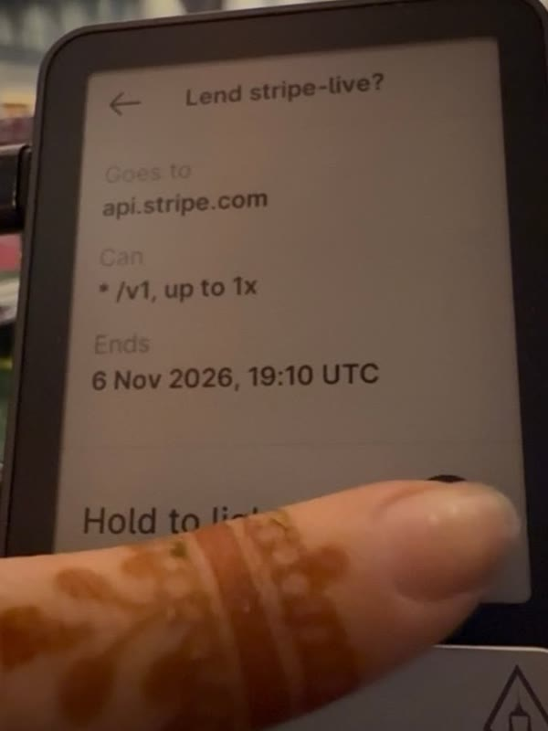
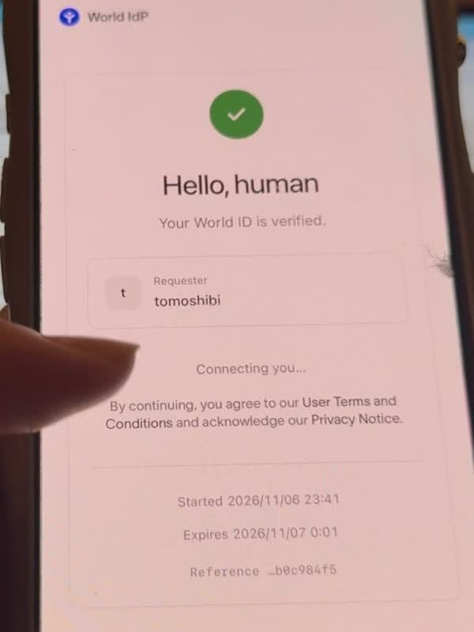
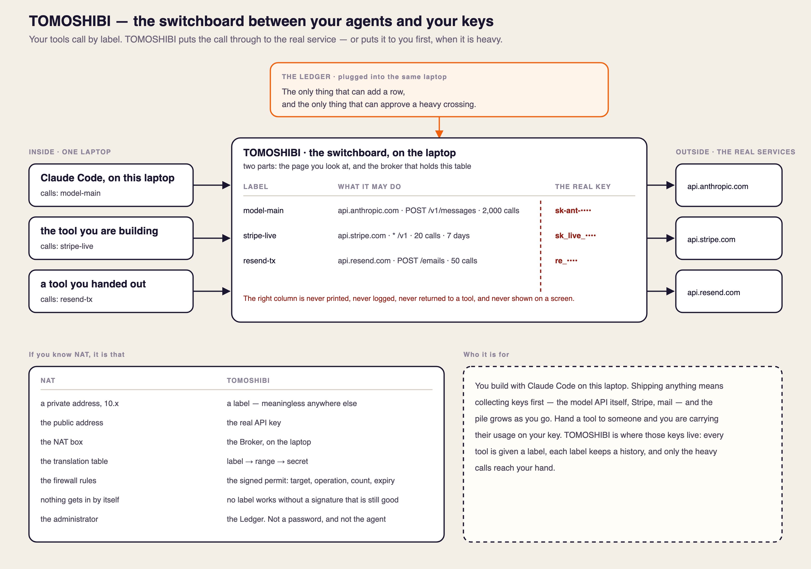
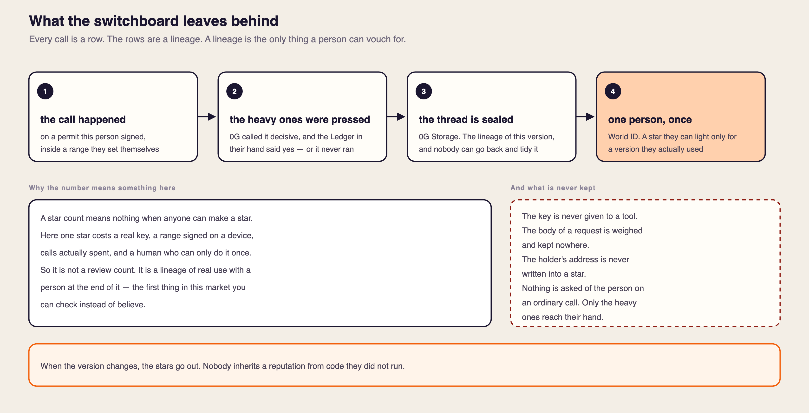

# TOMOSHIBI 🪔

**A hardware wallet exists to protect the one secret a person must never hand over.
In the agent era, that secret is no longer only a seed phrase — it is an API key.**

[](https://kou-uni.github.io/ethglobal-mumbai/web/watch.html)

**[▶ Watch in HD · 1 min 56 s](https://kou-uni.github.io/ethglobal-mumbai/web/watch.html)**
 · **[Try the app](https://mintannn.github.io/tomoshibi/app.html)**
 · **[See one call move through it](https://kou-uni.github.io/ethglobal-mumbai/web/switchboard.html)**
 · **[How it runs](docs/HOW-IT-RUNS.md)**

<sub>The walkthrough is the real app, driven click by click, with footage of the device and the phone beside it:
a real Ledger, 0G Private Computer and 0G Storage, and World ID. Stripe is a stand-in in this take and the chat is
scripted (the app marks both MOCK). Two scenes, the list of APIs and the email, were recorded on a second laptop.</sub>

<p align="center">
  
  &nbsp;&nbsp;
  
</p>

<sub>The real device and the real phone at the venue. Left: the Ledger shows the four lines it is about to sign, and waits
for a thumb. Right: World says *Hello, human* to the requester `tomoshibi` — one real person is behind the light.</sub>

An API key is now the thing worth stealing: it moves money, sends mail, deletes records, speaks as you.
And unlike a wallet, we hand it over casually — pasted into a config, into a prompt, into a tool we did
not read. **TOMOSHIBI puts an API key behind the same hardware button that has always protected a wallet.**

**The key does not cross the network. The permission does.** The secret stays on the owner's own machine;
what travels is one signature, made on the device, for one destination, a counted number of uses, until a
stated moment. The four lines the device displays are the same bytes it signs, so **the screen and the
signature cannot disagree, and a mistaken or hijacked call is refused before it happens** — not reported
afterwards.

**A review score never expires. A flame goes out. That is the whole idea.**

**In one line: a human-centred way to hold API keys.** A hardware wallet decides, a sealed model on 0G weighs
each call without us reading it, and World ID puts one real person behind every light. And it is built the way
the Ethereum Foundation's CROPS track asks — **the key stays on the owner's own machine, nothing we operate sits
in the path of a call, and all of it runs from this repository** — so it keeps working if we go away. The four
questions that track asks are answered, short, under [CROPS](#crops).

## In 30 seconds

| | |
|---|---|
| **Who it is for** | A builder who ships AI tools from one laptop, and has to collect API keys to do it: the model, Stripe, mail. |
| **What bothers her** | Every tool wants a key in a `.env` file. Each key is good for everything, forever, and afterwards she cannot say what it was used for. |
| **What TOMOSHIBI does** | It is the switchboard between her tools and her keys. It keeps one table: *label → where it goes → the real key*. A tool holds a label. Routine calls are put through. A heavy one, such as a refund, waits until she holds a button on her Ledger. A call to anywhere else is refused, and recorded. |
| **What she gets** | No key in a `.env` file. No heavy call without her. A trail she can read. And a **light** on the tool she built: proof that a real person really runs it, which other people choose by. |
| **What is real today** | A real Ledger, 0G Private Computer, 0G Storage and World ID, end to end. One API on the list (Stripe). The switchboard runs on her own laptop and is not yet inside a TEE. |

## Three parts, three jobs

None of them is asked to trust the others.

| | What it does here | Why it has to be this one |
|---|---|---|
| **Ledger** (hardware wallet) | Holds the press. The EIP-712 digest is computed **inside the device** from the four lines on its screen | Software can be told to sign something other than what it showed you. A device that builds the digest from its own display cannot |
| **0G** | **Decides and records.** A TEE-attested model weighs the request body — routine / significant / decisive — and that verdict decides whether a human must press. The trail is sealed to 0G Storage | Grading a request means reading it. **The sealed enclave reads it; we never do.** If 0G is unreachable we stop rather than invent a verdict |
| **World** | **Proves a person.** One verified human, once per version, lights the tool — through the OIDC device flow, from a Broker with no screen | A trust signal that can be bought is not a signal. Personhood is the only thing that makes "someone is really running this" unbuyable |

## How it works



Her tools do not hold keys. They hold **labels** — `stripe-live`. TOMOSHIBI keeps one table on the laptop,
*label → where it goes → the real key*, and the swap happens at the moment of sending, nowhere else. The Ledger
plugged into the same laptop is the only thing that can add a row to that table, and the only thing that can
approve a call the weighing called heavy. *If you know NAT, it is that: the label is the private address, the key
is the public one, the permit is the firewall rule, and the Ledger is the administrator.*

**Once per key**, she adds a row: she picks an API from the list of supported ones, parks the key, and holds the
button on her Ledger. **Then, for every call:**

| | What happens | What it refuses |
|---|---|---|
| 1 | The tool calls **by label**, with the permit she signed and its own signature on the request | — |
| 2 | The row is found and the permit checked: her signature, the destination, the count, the expiry | `DENIED` — outside what she signed. Recorded with the tool's own signature. **0G is never asked** |
| 3 | **0G Private Computer** weighs the request: routine, significant or decisive | `STOPPED` — no answer, so no verdict. There is no fallback judgement |
| 4 | Heavy? The tool has to come back with a signature from the Ledger, good for one call | `NEEDS_PRESS` — nothing runs while it waits. **This is the only step with a person in it** |
| 5 | One call of the count is reserved, the label is swapped for the key, and the call is sent | `DENIED` — the count is used up |
| 6 | The answer goes back to the tool, with a hash of it. Never the key | — |
| 7 | The call is appended to the trail (the Broker's own append-only file, on the same machine as the Broker), and the thread is sealed into **0G Storage** | — |

The refusal is the product. A tool that cannot say *which* kind of no it got is a tool you cannot leave alone.

Moving, one call at a time: [`web/switchboard.html`](https://kou-uni.github.io/ethglobal-mumbai/web/switchboard.html) · the figure, link by link: [`web/flow.html`](https://kou-uni.github.io/ethglobal-mumbai/web/flow.html)
· drawn out, step by step: [`assets/sequence.png`](assets/sequence.png)
· read off the code: [`docs/HOW-IT-RUNS.md`](docs/HOW-IT-RUNS.md)

## What accumulates: lights



Every call is a row, and the rows are a lineage. When the tool has really worked for her, she lights it:
**World ID** says she is one real person, and the trail says she holds a permit for this version and has
actually used it. Signing alone is not enough, and nobody can light the same version twice.

A star count means nothing when anyone can make a star. Here one light costs a real key, a permit signed on a
device, calls actually spent, and a person who can only do it once. **When the version changes, every light on
it goes out**, so only the people still running it notice, and light it again. That is why the count means
*in use right now*, and why the lights add up to something a builder can be chosen by.

## What is real, what is a mock, what is not built

| | |
|---|---|
| **Real, end to end** | The Ledger app (Rust, no blind signing) · the permit check · the weighing on 0G Private Computer · the press for a heavy call · the trail, sealed into 0G Storage · the light through World ID |
| **Real, with a limit** | **Stripe, in test mode**: a test key can be parked from the page and the call then goes to Stripe for real; a live key is refused before it is stored. Built and tested up to Stripe's own refusal of a bad key; a full run with a real test key is still to be done. Without a parked key Stripe is a stand-in, and the page says `MOCK` |
| **A mock, and marked so on screen** | The chat with the AI is scripted · the stand-in button when no Ledger is connected · 0G and World when the Broker runs without their keys |
| **Not built** | The Broker inside a TEE · a drop-in proxy (today a tool calls `POST /use`) · any API but Stripe (the list says *not supported yet*) · lights counted per builder (they are counted per tool version) · anonymous reads of lights |

**Facts that can be checked**

| | |
|---|---|
| A trail sealed on **0G Galileo (chainId 16602)** | tx [`0x74c7cdf9…aef1`](https://chainscan-galileo.0g.ai/tx/0x74c7cdf9bca055c502918e62a7ac9fc7634d1326471433ab10161045aa97aef1) · block **64103318** · `status 0x1` |
| Sealed while the walkthrough was being recorded | [`0x9fb05d18…c41f`](https://chainscan-galileo.0g.ai/tx/0x9fb05d1853a72faf440dd275e083e26979ba26da6d48b27b157702203a99c41f) · [`0xaaf40817…6664`](https://chainscan-galileo.0g.ai/tx/0xaaf408174f454563f789b40e1ef639f45f23fd675207625aee9daacc0bbb6664) |
| Measured against the **real** 0G Private Computer (TeeML) | **467 calls** · 2.0 s per verdict · **$0.000036** per verdict. Every verdict carries 0G's request id, in the trail and on the screen |
| Tests | **60 / 60** (`broker/test`), including 100 concurrent requests against a budget of 3, and a signature vector the device and the Broker must agree on (`spec/permit-signature.md` §6) |
| Hardware | A custom **Ledger** app in Rust: [`ledger-app/`](ledger-app/). The host never sends a digest |
| **World ID, against the live issuer** | Verified on a phone at the venue, **2026-11-06 23:41 IST** — requester `tomoshibi`, reference `…b0c984f5` |

## CROPS

The Ethereum Foundation track asks for four properties — censorship resistance, open source, privacy,
security — and for a README that says what the authors control, whether it builds from the repository alone,
and how keys are protected. TOMOSHIBI is built to those properties rather than fitted to them afterwards. The
lead property is **security that holds without us**: the key never leaves the owner's machine, a hardware
wallet decides, and nothing we operate can be told to sign, to leak, or to cut someone off. The short answers
first; where to check each, below.

| The track asks | Short answer |
|---|---|
| **C** · What do you control that the user depends on, and what happens if it goes away or refuses them? | **Nothing in the path of a call.** The Broker is the user's own process, the screens are static files, the Ledger app is on their device. If we vanish, all of it keeps running from this repository; only the public try-out page (ours, and it takes no keys) goes dark. We cannot refuse anyone: we hold no key and no account. One registration is needed for lights — a World app id, ours in the demo and your own in `.env.local` if you run it |
| **O** · Can a user build and run it from the repository alone? | **Yes.** The Broker is Node with four dependencies (`npm test`, then `tools/demo-up.sh`), the screens are a static folder, and the Ledger app builds from LedgerHQ's boilerplate. [Run it](#run-it) |
| **P** · What does the client send to third parties? | **Nothing.** No analytics, no fonts, no embeds, no cookies. The API key never leaves the Broker; the signing key never leaves the Ledger; the public trail holds no body and no key |
| **S** · How are keys and user data protected, and what are the trust assumptions? | A hardware wallet signs every permit from the four lines on its own screen; the Broker enforces destination, count and expiry on every call; a heavy call waits for a press; a call to anywhere else is refused and recorded. **Trusted:** the Broker on the owner's machine (not in a TEE yet), TeeML's attestation for the weighing, World for personhood |

**Censorship resistance.** The switchboard runs on your own laptop: the Broker is a local process and the
screens are static files, so no server we operate sits in the path of your calls. Your keys are your own —
we never hold them, so we cannot cut anyone off, and anyone can run the whole thing from this repository.
The trail is sealed to 0G Storage, a public network, so it cannot be withheld, quietly edited or deleted by
us. Refusals are written to the trail next to the calls that went through, so a tool being stopped is visible
rather than silent. What this does *not* survive: with World ID unreachable no new light can be lit (the gate
still works), and with 0G unreachable a request is `STOPPED` rather than judged — we refuse rather than fall
back to a weaker rule.

**Open source.** MIT, public repository, no hidden build: the screens are static files with no bundler, the
Broker is Node with four dependencies, the Ledger app is in [`ledger-app/`](ledger-app/) (Apache-2.0, from
LedgerHQ's boilerplate), and every figure in this README is generated by `assets/build-figures.py`.

**Privacy.** The screens load nothing from a third party: no analytics, no pixels, no web fonts, no embeds,
no cookies. What the page keeps in the browser is its own state and, after a light, your World pseudonym;
never a key. The real API key never leaves the Broker and is never handed to the tool; the signing key never
leaves the Ledger. The public trail holds no request body and no key, only a hash of what came back.

| | Learns | Does not learn |
|---|---|---|
| **Ledger** | The four lines (key label, destination, count, expiry), and whether it was held | The body of any request. The API key |
| **World** | **That this is a person, and the same person** (a per-sector pseudonym) | Which tool was lit · which key · when it was used |
| **0G Private Computer** | The body of the request, **inside the enclave**, to weigh it | Either key |
| **0G Storage** (the trail) | Who permitted it, what was asked for, and whether it went through or stopped | **No body, no key.** It is written to be public |
| **The Broker** | Everything: the key, the permits, the verdicts, the trail | — **It is the one point of trust.** It runs on the owner's own machine |

*The exceptions, said plainly.* The Broker is not inside a TEE this time. The public demo page talks to one
demo server of ours so that it can be tried without installing anything; that server takes no keys, and
everyone who opens the page shares one session. The 0G router reports `x-0g-e2ee: none` for the model now in
use, so we do not claim more than what TeeML attests.

**Security.** Every permit is an EIP-712 structure signed on hardware, and the device computes the digest
itself from the same four lines it displays, so the host cannot ask it to sign something other than what the
person read. Destination, count and expiry are enforced on every request, with four distinct refusals rather
than one generic failure. A parked key lives in memory only, and only test-mode keys are accepted. Secrets
live in a gitignored `.env.local` and are never printed.

## Why this is not the thing next to it

| The thing next to it | What it decides | What it leaves open |
|---|---|---|
| A secrets manager | *Where a key lives* | It stores the secret well, then issues it intact. It is a safe, not a limit |
| A key broker or proxy for agents | *That the tool never sees the key* | Whether **this** call, right now, was allowed by a person. These exist; putting the key behind a proxy is not the new part |
| Hardware approval for agents' transactions | *That a person approves a transfer* | Ordinary API calls: a refund, an email, a deletion |
| A star rating | *How many people clicked* | Whether any of them is a real person who still runs it |

**None of them decide whether this one request was allowed by a human, weigh it without reading it themselves,
and keep the refusals.** And none of them turn that record into a reputation that goes out when the code changes.

## Run it

```bash
git clone https://github.com/kou-uni/ethglobal-mumbai && cd ethglobal-mumbai
tools/demo-up.sh                  # Broker, the tool, the bridge to the Ledger, the pages; reads broker/.env.local
open http://localhost:8790/app.html
cd broker && npm i && npm test    # 60 / 60
```

Without keys in `broker/.env.local` the same thing runs with 0G and World simulated, and says so on every screen.

| | |
|---|---|
| **The app** | https://mintannn.github.io/tomoshibi/app.html |
| The walkthrough | https://kou-uni.github.io/ethglobal-mumbai/web/watch.html |
| One call, moving through the switchboard | https://kou-uni.github.io/ethglobal-mumbai/web/switchboard.html |
| The business model, the lean canvas and three years of cash | https://kou-uni.github.io/ethglobal-mumbai/ideation/2026-11-06-business-model.html |

## Where it goes next

**The Broker inside a TEE**, so the one remaining point of trust goes away · **a drop-in proxy**, so a tool
changes a base URL and nothing else · **more APIs on the list** · **lights per builder**, so a name carries
across the tools she ships · **anonymous reads of lights**, so looking a tool up does not say which tool you
care about.

## How we built it (disclosure per the ETHGlobal rules)

**Built inside the hacking window (from 11/5 21:00 IST).** No pre-existing project-specific code.

| Where | Origin | License |
|---|---|---|
| `ledger-app/` | Started from LedgerHQ **`app-boilerplate-rust`** (the app itself was written here) | Apache-2.0 |
| `broker/` dependencies | `viem` / `jose` / `ethers` / `@0gfoundation/0g-storage-ts-sdk` | Respective OSS licenses |
| `bridge/bridge.py` | `hidapi` (Python) | Respective OSS licenses |

Everything else (`broker/src/`, `web/`, `ui/`, `spec/`, `ideation/`, `tools/`) **was written here**.

**We used Claude Code (Anthropic) throughout, and say where.**

| Scope | How |
|---|---|
| `broker/src/`, `broker/test/` | **A human decided the design, the AI wrote it, a human verified it with tests.** The boundaries of the verdict (the ways to stop, scope matching, the call budget) were written by a human as a spec first (`spec/`) |
| `web/`, `tools/`, the walkthrough | **minta decided the screens, the flow and every word; Claude Code wrote the code.** She checked each screen in the browser and on the real device, and filmed the device and the phone herself |
| `ledger-app/` (Rust) | **Built by minta on real hardware**, with AI assistance |
| `ideation/`, `research/`, `docs/` | Used to draft the structure and the prose. **Only numbers, verdicts and measurements a human ran and confirmed are on the page** |

Nothing the AI made and a human did not check is in the submission. Any number we did not measure ourselves is
marked [unverified]. How we prompted it and what we rejected is on the record too:
`ideation/2026-11-06-decisions.md`.

## Further reading

| | |
|---|---|
| [`docs/HOW-IT-RUNS.md`](docs/HOW-IT-RUNS.md) | Processes, state and sequence, read off the code. If anything here disagrees with it, that page is right |
| [`POSITION.md`](POSITION.md) | Who this is for, what it stops, and what it assumes |
| [`START-HERE.md`](START-HERE.md) | The current state, how to run it, what is next |
| [`spec/permit-signature.md`](spec/permit-signature.md) · [`spec/world-agent-pass.md`](spec/world-agent-pass.md) | The contract between the Ledger and the Broker · how World is called |
| [`ideation/2026-11-06-world-integration-notes.md`](ideation/2026-11-06-world-integration-notes.md) | What integrating World took: time to first success, where we lost an hour, what was missing from the docs |
| [`ideation/2026-11-06-decisions.md`](ideation/2026-11-06-decisions.md) | The numbered decisions, each with what we rejected |
| [`docs/README-ARCHIVE.md`](docs/README-ARCHIVE.md) | The longer sections that used to be on this page: why India picked this problem first, what was hard, the decision records, and our own reading of where this is strong and weak |
| `ideation/README.md` | An index of all the working documents |
