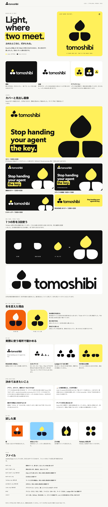

# tomoshibi — Logo

Kouさんが選んだ EC Meet（Issue #33）を元に、Yohaku v3 のやわらかさで描き直したロゴ。

## シンボルの物語

2つの器が向き合い、そのあいだに灯が1つともる。

器と炎は同じ輪郭を使っている。左の器を反転すると右の器に、42° 回すと炎になる。灯が消えると器だけが残る（`mark-out.svg`）。

器の高さは文字の x ハイトと同じで、文字と同じベースラインに立つ。

## 色

| | |
|---|---|
| Lemon | `#FFF05A` |
| Black | `#111111` |

- 白とレモンの地：黒1色（`mark.svg`、`lockup.svg`）
- 黒地：器と文字は白、炎はレモン（`mark-light.svg`、`lockup-light.svg`）

レモンの炎は白地だと見えにくいので使わない。

## アセット

SVG はすべてパスのみで、フォントがなくても同じ形で表示される。

- [mark.svg](mark.svg) / [mark-light.svg](mark-light.svg)：マーク
- [mark-small.svg](mark-small.svg) / [mark-small-light.svg](mark-small-light.svg)：24px 以下用。すき間を広げた版
- [mark-out.svg](mark-out.svg)：灯が消えた状態
- [lockup.svg](lockup.svg) / [lockup-light.svg](lockup-light.svg)：マークと文字の横組み
- [wordmark.svg](wordmark.svg) / [wordmark-light.svg](wordmark-light.svg)：文字だけ
- [icon.svg](icon.svg) / [icon-dark.svg](icon-dark.svg) / [favicon.svg](favicon.svg)：アプリアイコンとファビコンの元データ
- `png/`：`icon-512.png`、`icon-192.png`、`apple-touch-icon.png`、`icon-dark-512.png`、`favicon-16〜64.png`、`mark-1024.png`、`mark-light-1024.png`、`ledger_32x32.png`、`ledger_40x40.png`
- [index.html](index.html)：ブランドボード
- [preview.png](preview.png)：ボードのプレビュー

## 透過ファイル

他の人に渡すときは `transparent/` を使う。背景なしで、ファイル名だけで用途が分かる。

- `for-light`：白やレモンなど明るい地用。黒1色
- `for-dark`：黒など暗い地用。形と文字は白、炎はレモン（文字だけの版は白）

| 種類 | PNG（幅 px） | SVG |
|---|---|---|
| マーク | `tomoshibi-mark-{for-light,for-dark}-{1024,512,256,128}.png` | `tomoshibi-mark-{for-light,for-dark}.svg` |
| マーク（24px 以下用） | `tomoshibi-mark-small-{for-light,for-dark}-{32,16}.png` | `tomoshibi-mark-small-{for-light,for-dark}.svg` |
| マークと文字の横組み | `tomoshibi-lockup-{for-light,for-dark}-{2000,1000,500}.png` | `tomoshibi-lockup-{for-light,for-dark}.svg` |
| 文字だけ | `tomoshibi-wordmark-{for-light,for-dark}-{2000,1000,500}.png` | `tomoshibi-wordmark-{for-light,for-dark}.svg` |

PNG は `transparent/png/`、SVG は `transparent/svg/` にある。`icon.svg`、`icon-dark.svg`、`favicon.svg` は背景つきなので、透過が必要なときは使わない。

## カバー

`cover/` にある。文字は Issue #31 の一文だけで、罫線と影は使っていない。

| ファイル | 用途 |
|---|---|
| `cover-1200x630.png` / `cover-black-1200x630.png` | ETHGlobal の提出、リンクのプレビュー |
| `github-social-1280x640.png` | GitHub の Social preview |
| `readme-banner-1280x320.png` | README のバナー |
| `x-header-1500x500.png` | X のヘッダー |
| `slide-title-1920x1080.png` | スライドの表紙 |

`cover/src/` に文言を直せる HTML がある。カバーの文字は macOS 付属の Avenir Next なので、別の環境で書き出すと字形が変わる。

ロゴの文字は市販の書体を使わず、9文字を線から描いた。SVG と HTML/CSS で制作し、画像生成は使っていない。

## 未確認のこと

- Ledger の 1bit 画像は実機で確認していない。
- `web/`、スライド、`assets/tomoshibi-cover.png` への差し替えはしていない。アプリの主色はまだ橙（`#F2600C`）のまま。

## 残っている判断

- アプリ、スライド、既存カバーをどうするか（ロゴだけ変えると配色が2系統になる）
- 🕯️ と置き換えるか、ロゴだけ小文字にするか
- 器のすき間（原案の「ふれる」を「ふれる寸前」に変えている）
- 器と炎の構成がディワリの灯に見えないか（Issue #33 の質問）
