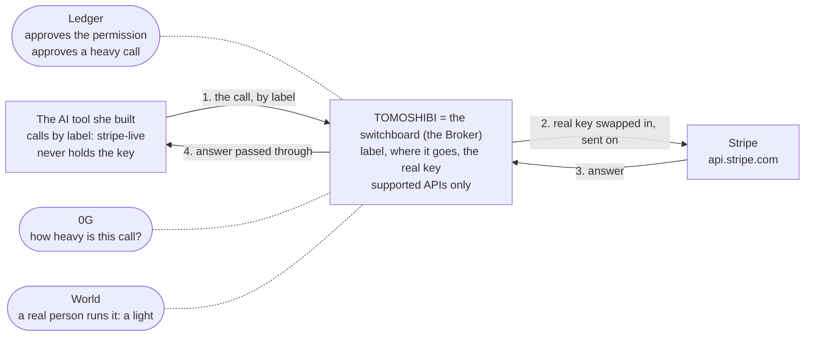
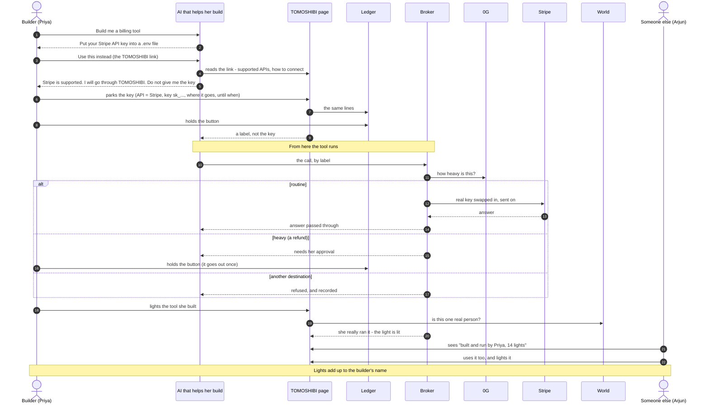

# Direction, 6 Nov 21:30 IST — drafts for a clean copy

Agreed between Minta and Kou tonight. The two figures below are Minta's drafts. Kou redraws them.
`docs/STRUCTURE.md` describes the structure as it was before this; the Broker's order of steps in it is still right.
The words follow the README on main (299d4f8): *switchboard*, *label*, *table*, *row*, *puts the call through*.

## What changed

1. **The person.** A builder who has the skill and is tired of managing API keys. Not a shop owner without the skill.
2. **TOMOSHIBI is a Broker, and nothing else.** The switchboard between her tools and her keys, approved on a hardware
   wallet. It does not lend anything.
3. **Supported APIs only.** There is a list. For an API on the list, TOMOSHIBI knows where it goes and how the key is put in.
   Today one entry works: Stripe.
4. **It keeps the key, swaps it in, and passes the request and the answer through**, the way NAT swaps an address.
   The tool holds a label (`stripe-live`) and never the key.
5. **The permission she approves has three things**: the key, where it goes, until when. There is no "can" line on the page.
6. **Lights.** The builder lights the tool they built and really run through TOMOSHIBI. World proves a person, the Broker's
   trail proves the use. Lights add up to the builder's name, and other people choose tools by that.
7. **The chat.** The AI asks for a key. She sends the TOMOSHIBI link. The AI reads it, sees the API is supported, and decides
   to go through TOMOSHIBI.

## Kept on purpose

- **The weight on 0G and the press on the Ledger stay in the path.** The 0G prize needs inference in the main flow, and this
  is the difference from a plain key proxy (those exist: Infisical Agent Vault, for one).
- **The Broker is run by the builder, on their own machine**, as it is today. EF CROPS asks that keys stay on the device;
  "a service that keeps your keys" would be the opposite.
- **The word is *light*.**
- **The name Priya stays.** She is now a developer who builds a billing tool. Arjun is the person who chooses it.
- **The Ledger app's four lines are not changed tonight.** The page drops the "can" row. The device still shows `SCOPE`.

## Figure 1 — TOMOSHIBI is only a Broker

## Figure 2 — the new flow

## What changes in the app tonight (`minta/story`)

| # | Where | Change |
|---|---|---|
| 1 | The chat tab | A builder talking to the AI that helps her build. After she sends the link, the AI reads it, finds Stripe on the list and decides to go through TOMOSHIBI. |
| 2 | A page an AI can read | `web/llms.txt`: the supported APIs and how to connect. The link in the chat is real. |
| 3 | Adding a row | One screen: pick an API from the list (only Stripe works), the key, where it goes (fixed by the list), until when. No "can" row. Only the Ledger can add the row. |
| 4 | After the approval | A screen that gives the tool its label, with the call the tool makes. |
| 5 | Home | The table (label, where it goes, until when, the key hidden) and a call being put through: the tool, TOMOSHIBI, Stripe, and the answer coming back. |
| 6 | Lights | "Light the tool you built", the lights you have, and the sample where someone chooses by them. |
| 7 | Name on the page | Priya as a builder. |
| 8 | 0G Storage | The tool seals each finished thread (`POST /seal`) and the trail shows it. |
| 9 | 0G credits | Shown on the page. |

## Not tonight

- A drop-in proxy (change the base URL and the key, nothing else). Today the tool calls `POST /use`. This needs the Broker to
  keep the permit behind the label.
- A real call to Stripe. It is still the stub (`EXECUTE=0`).
- Lights counted per builder. Today they are counted per tool version; the page shows a sample.

## Still to rewrite for this direction

README, `POSITION.md`, the wording in `docs/HOW-IT-RUNS.md`, the journey, the submission text and the pitch.
The submission text also still names the 0G model that was removed (`0gm-1.0-35b-a3b`; the demo runs `0gm-1.0-35b-a3b-sia`).
