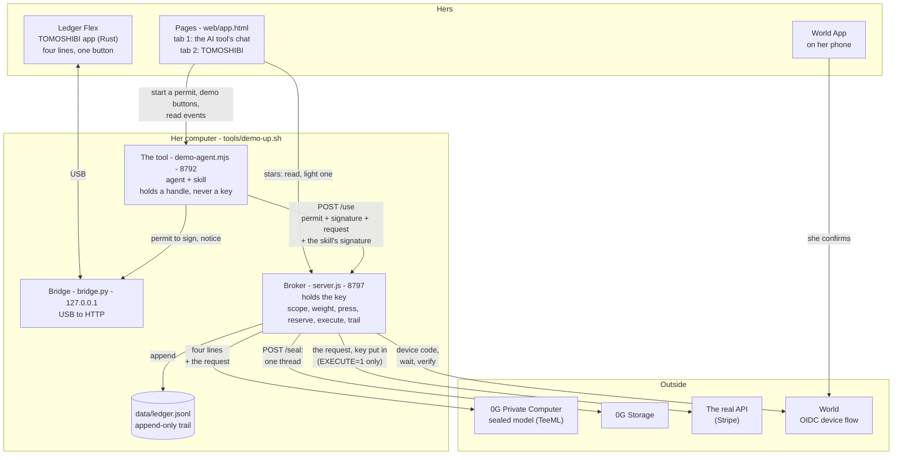
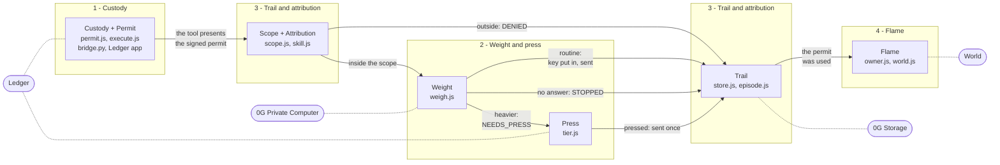
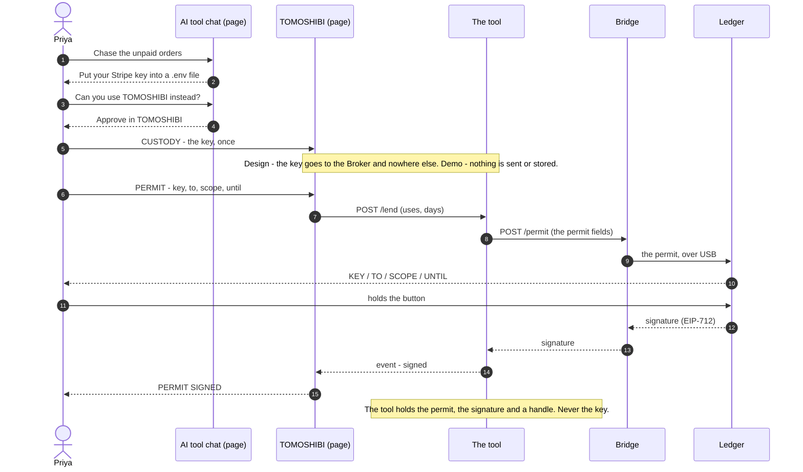
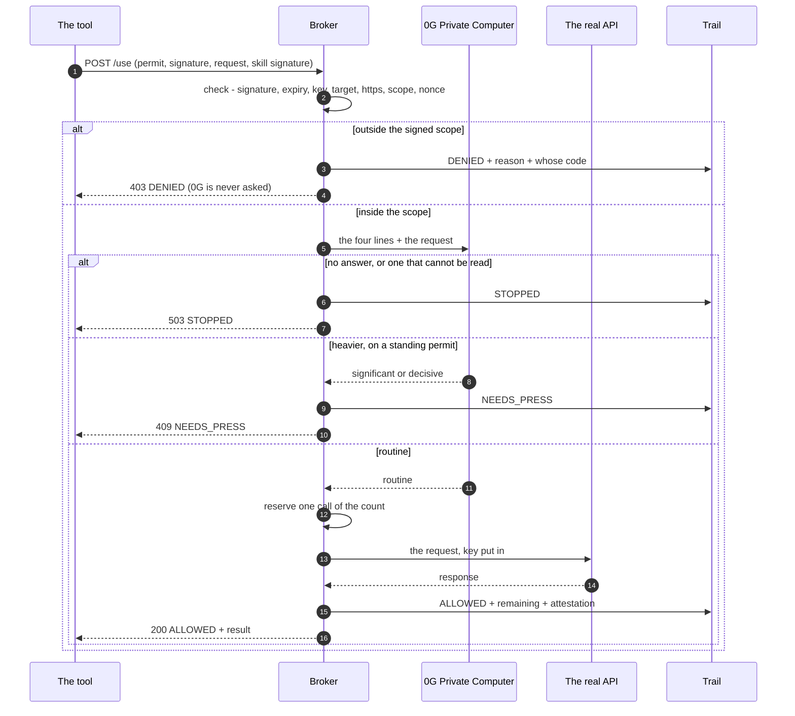
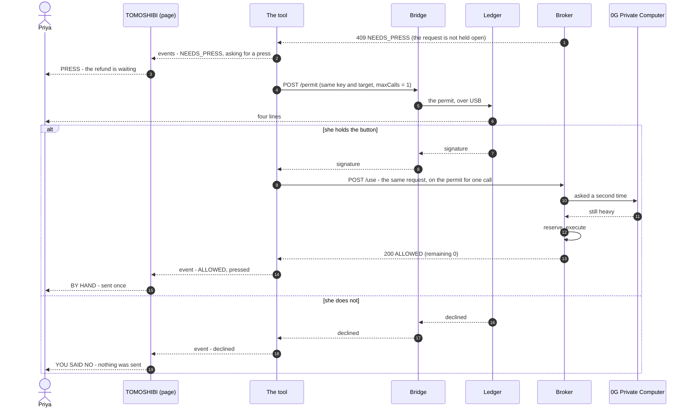
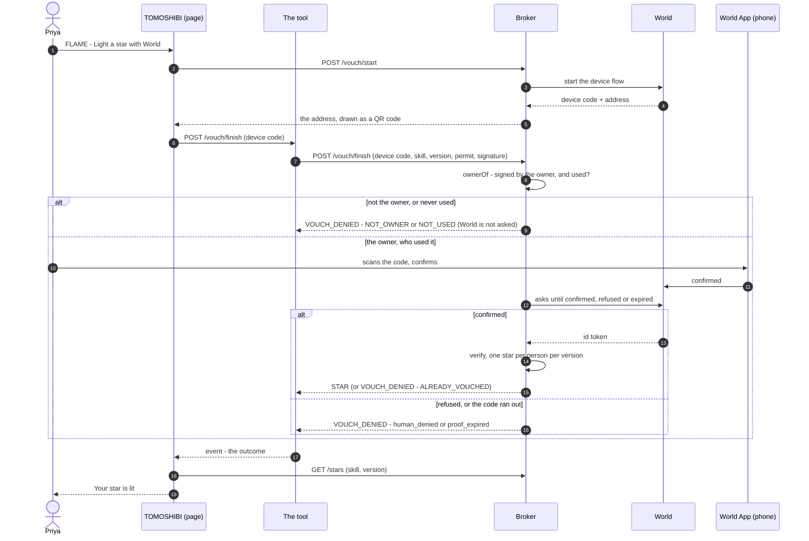

# Structure — parts, functions, sequences

Three figures of the same system, so that the pages, the Broker and the pitch describe one thing.

Written from [`HOW-IT-RUNS.md`](HOW-IT-RUNS.md) and the code. It adds what that page leaves out:
the pages a person sees (`web/app.html`) and how they reach the rest. About the Broker, if this
page disagrees with `HOW-IT-RUNS.md`, that page is right. Section 5 lists where the branch
`minta/story` is different from it today.

The figures are also kept as pictures in [`figures/`](figures/), for the deck.

Sources: `broker/src/server.js`, `scope.js`, `tier.js`, `weigh.js`, `owner.js`, `world.js`,
`broker/demo-agent.mjs`, `bridge/bridge.py`, `web/flow.js`, `tools/demo-up.sh`, `tools/hosted-start.sh`.

## 1. Words

One meaning each. The left column is what the README ("four parts") and the journey fixed.
The app uses the left column.

| Word | It means | The same thing is also written as | No longer used in the app |
|---|---|---|---|
| **key** | The API secret. It stays with the Broker. | secret | |
| **handle** | What the tool holds instead of the key: `keyRef`, plus the signed permit. | *label* (`HOW-IT-RUNS.md`, the figures) | |
| **permit** | The EIP-712 message she signs: `holder, skill, version, key, target, scope, maxCalls, expiry, nonce`. Shown as four lines: `KEY / TO / SCOPE / UNTIL`. | | |
| **scope** | Where the key may go and what it may do there, how many times, until when. | *range* | |
| **sign the permit** | The hold on the Ledger that makes a standing permit (`maxCalls` > 1). | *lending the key* (journey heading, `assets/lending.svg`); `/lend` and `standing` in the tool's code | *lend*, *lent* |
| **press** | The hold on the Ledger for one heavy request: a permit with `maxCalls = 1`, signed now. | | *your hand* |
| **weight** | `routine` / `significant` / `decisive`, said by the sealed model on 0G. | | |
| **trail** | The append-only record of every request, allowed or refused. | the record | *your week*, *activity* |
| **star** | What the owner lights on one version after using it, through World ID. **Flame** is the name of that function. | *a flame on that version* (the figure) | *light* |
| **the stops** | `DENIED`, `NEEDS_PRESS`, `STOPPED`, `human_denied` / `proof_expired` | | *blocked*, *no verdict* |

## 2. Parts

Who exists, where it runs, and who talks to whom.

- **The Broker never talks to the bridge or to her device.** The tool does, over `127.0.0.1`.
- **The pages decide nothing.** They read the tool's events (`GET /events`) and draw them. They never talk to 0G,
  World or the API. For stars they ask the Broker (`/stars`, `/vouch/start`), and the tool for the finish.
- **While filming there is no real key and no real call**: `EXECUTE=0`, `SECRETS` unset. The *Custody* screen
  sends and stores nothing.
- The Broker without 0G (8798, to show `STOPPED`) and the static file server (8790) are left out of the figure.
- A hosted copy exists on the branch only. See section 5.

## 3. Functions

The four parts of the README, the six functions of the journey, and the code behind each.

| Function | What it does | Code | Outside | What it answers | Screen (the bar under the name) | What she gets |
|---|---|---|---|---|---|---|
| **Custody + Permit** | The key stays with the Broker and the tool gets a handle. The permit is signed on hardware, as four lines built from the bytes that are signed. The key is put in only at the moment of sending. | `permit.js`, `execute.js`, `bridge.py`, the Ledger app | Ledger | a signature, or nothing | `CUSTODY` → `PERMIT` → `PERMIT SIGNED` | You never hand the key over. You hand over one use of it. |
| **Scope + Attribution** | Before anything runs: the holder's signature, expiry, key, target, https, operation, nonce. A request outside the scope is recorded with the skill's own signature. | `scope.js`, `skill.js` | none | `DENIED`: `BAD_SIGNATURE`, `EXPIRED`, `WRONG_KEY`, `OUT_OF_TARGET`, `INSECURE_TRANSPORT`, `OUT_OF_SCOPE`, `REPLAY`, and `EXHAUSTED` when the count is used up | `SCOPE + ATTRIBUTION` | It did not get anywhere, and it has a name on it. |
| **Weight** | A sealed model reads the four lines and the request and says how much it matters. No answer means no verdict. | `weigh.js` | 0G Private Computer | `routine` / `significant` / `decisive`, or `STOPPED` (`ZG_UNREACHABLE`) | `WEIGHT` | On an ordinary day it asks you nothing. |
| **Press** | From `ZG_ESCALATE` upward (`decisive` by default, `significant` in the demo) a standing permit is not enough. It needs a permit for one call, signed now. | `tier.js` | Ledger | `NEEDS_PRESS` (`ESCALATED`) | `PRESS` | Money cannot move while you are away. |
| **Trail** | Every request, allowed or refused, is appended with its reason. A thread can be sealed into 0G Storage. | `store.js`, `episode.js` | 0G Storage | `ALLOWED`, `DENIED`, `NEEDS_PRESS`, `STOPPED`, `SEALED` in one file | `TRAIL` (tab) | You can say what was stopped, and whose code tried it. |
| **Flame** | A star on one version. Only the owner of a permit that was used can light it, confirmed once through World. Stars are counted per version. | `owner.js`, `world.js` | World | `STAR`, or `VOUCH_DENIED`: `NOT_OWNER`, `NOT_USED`, `human_denied`, `proof_expired`, `BAD_ID_TOKEN`, `ALREADY_VOUCHED` | `FLAME` (tab) | You choose by whose star it is, not by how many. |

## 4. Sequences

### 4.1 Once: the key, then the permit (Monday)

The route is still called `/lend` in the tool's code. Nothing a person reads says so.

### 4.2 One request (every time)

- No call left in the count: `DENIED / EXHAUSTED`, at the reserve step.
- While `EXECUTE=0` the request to the real API is a stub.
- After a `DENIED`, the tool asks the bridge to show a notice on her Ledger (`POST /notice`). Nobody has to tap.

### 4.3 A press (Wednesday)

### 4.4 A star (Friday)

Her wallet address is never written into the star. When the version changes, the stars of the old version are
simply not counted any more.

## 5. Where the branch `minta/story` differs from `HOW-IT-RUNS.md`

To settle between us. Each row is a fact about the branch, not a proposal.

| Topic | `HOW-IT-RUNS.md` (main) | `minta/story` |
|---|---|---|
| Words | *label*, *range*, *a flame on that version* | *handle*, *scope*, *star*: the README "four parts" words. Same things. One set should win everywhere; the app follows whichever it is. |
| Bridge port | 8791 | 8791 by default. The filming laptop runs it on 8793 (`BRIDGE_PORT=8793 tools/demo-up.sh`). |
| "None of it is a service in the cloud" | True | Still true for filming. The branch adds an optional hosted copy so the pages can be tried from any device: Broker and tool in one container (`tools/hosted-start.sh`), no bridge, no wallet key (`ZG_PRIVATE_KEY` is dropped), `EXECUTE=0`, rate-limited, and only `/vouch/start` and `/vouch/finish` are passed through to the Broker. |
| The Ledger without a bridge | Not described | Only on the hosted copy, which has no USB: the page opens the device itself and carries the same bytes. Where a bridge runs, only the bridge talks to the device. |
| 0G model | `0gm-1.0-35b-a3b` | That model has been removed from 0G (404 since 17:32 IST on 6 Nov). The branch defaults to `0gm-1.0-35b-a3b-sia` with `ZG_JSON_MODE=0`. |
| The end of the World flow | `/vouch/finish` answers its caller | The tool keeps the outcome and also sends it as an event, so a page that lost the long request still changes. |
| `POST /seal` | Listed | The app does not call it. Only `broker/demo.mjs` does. |
