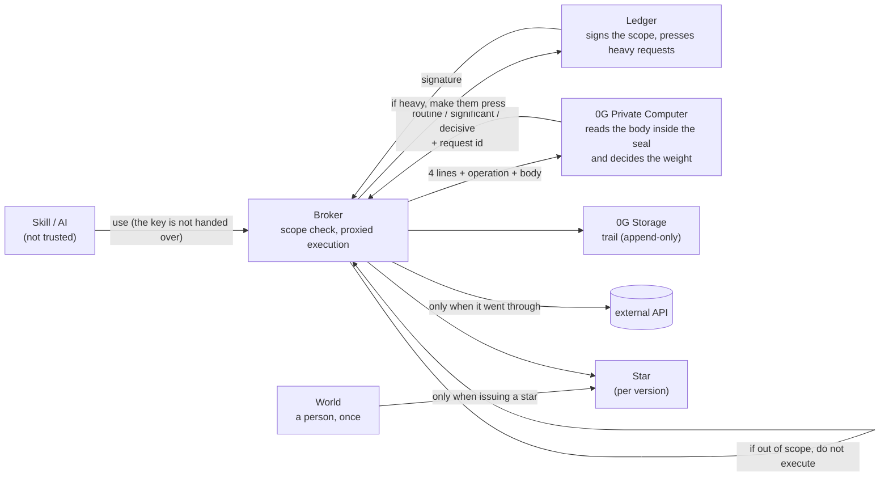

# Architecture v3 (2026-11-06 morning — **rewritten to match the implementation**)

> v2 (`2026-11-06-architecture.md`) still had things we threw away (M5Stick, Stack-chan, ENS,
> ViolationRegistry) in the diagram, and 0G's role was still the old one, "read the response and warn."
> **v3 is the current truth.**
> **What is running and what is not are written separately.**

---

## 1. One sentence

**An AI can use a key without holding it. The scope is signed on a device in your hand, the weight is
decided by a sealed AI, and a request outside the scope stops before it executes, leaving evidence.**

## 2. What happens, in order, in one use

```
① A skill sends a use           (the key is not handed over. The request carries the skill's own signature)
② The Broker checks it against the scope → outside it  ✗ DENIED       not executed, recorded as a violation
③ 0G reads the body of the request and decides the weight → unreachable ✗ STOPPED   no judgment is made (safe-stop)
④ If heavy, a press on the device is required → not pressed   ✗ NEEDS_PRESS  the key is not used
⑤ The Broker calls the API on its behalf → it went through   ✓ ALLOWED      recorded with a hash of the response
⑥ The trail is put on 0G Storage  (a root hash comes out. Neither the body nor the key goes in)
```

**On a separate line, World is involved only when a star is issued.**

```
⑦ Issue a star (= declare that you use this version)
   → World confirms "a person, and the same person" exactly once
   → refused               ✗ human_denied    no star
   → expired               ✗ proof_expired   no star
   → confirmed             ✓ STAR            one per person per version
```

## 3. The fact that there are four kinds of refusal is the substance of this design

**Do not settle for a single word, "it stopped." A different way of stopping means a different place
for liability.**

| | Who stopped it | What it means | Where |
|---|---|---|---|
| `DENIED` | **A line the owner drew in advance** | A request outside the declared scope. **Recorded together with the skill's signature** | Broker (`src/scope.js`) |
| `STOPPED` | **Nobody stopped it. It cannot be decided** | 0G is unreachable, so the weight cannot be determined. **We do not let things through undecided** | Broker (`src/weigh.js`) |
| `NEEDS_PRESS` | **Right now, a person has not pressed yet** | A heavy request. A standing permit does not let it through | Broker (`src/tier.js`) |
| `human_denied` / `proof_expired` | **A person refused / nobody was there** | No star is issued. The refusal is also kept | World (`src/world.js`) |

## 4. Parts (**only what is running right now is in bold**)

| Location | Part | What it holds | State |
|---|---|---|---|
| In hand | **Ledger (our own app)** | The root key | **Running on the real device** (minta / `minta/ledger-app`). The digest is computed on the device |
| In hand | **Broker** | Child tokens, the trail | **Running** (`broker/`, 50 tests). **This is the single point of trust** |
| External | **0G Private Computer (TeeML)** | The body of the request (inside the seal) | **Wired up**. Waiting on the API key (`0gm-1.0-35b-a3b`, tee_attested) |
| External | **0G Storage (Log layer)** | The trail | **Wired up.** Measured up to the point where the tx is assembled. Waiting on gas (Flow `0x22E0…5296`) |
| External | **World (Agent Pass)** | Proof of being a person | **Wired up**. Waiting on client registration (OIDC device flow) |
| Screens | Star field, records | — | minta is implementing |
| Chain | VouchRegistry | Stars | **Not deployed.** Stars are in the Broker's append-only log. `verifyingContract` is frozen at 0x0 |
| — | Anon-RPC | Reading stars | **Design only** (depends on the EF / #6 decision) |

## 5. Who knows what (**separated by design**)

| | Knows | Does not know |
|---|---|---|
| Ledger | The four lines of scope, whether it was pressed | The body of the request |
| World | That it is a person, and the same person (pseudonymously) | What the star was issued for, which key it is |
| 0G (TeeML) | **The body of the request** (inside the seal) | The key in plaintext. **We cannot read it either** |
| Broker | Scope, judgments, the trail | — **The point of trust. This time it is not running in a TEE** |
| The trail (public) | Who permitted it, what was requested, whether it went through or stopped | Neither the body nor the key goes in |

## 6. Diagram



## 7. Limits (**do not quietly make it look better**)

- **The Broker holds the key. The point of trust is this one place.** In production the right move is
  to run the whole Broker on the 0G Private Computer. We have not done that this time
- **Stars are not on chain.** They are in the Broker's append-only log. VouchRegistry is not deployed
- **There is a simulation mode** (`ZG_OFFLINE` / `WORLD_OFFLINE`). It leaves `simulated: true` in the
  record. **Turn it off for filming**
- Version matching (automatically going dark when `version` changes) only holds on the star-reading
  side. The Broker does not look at `version`
