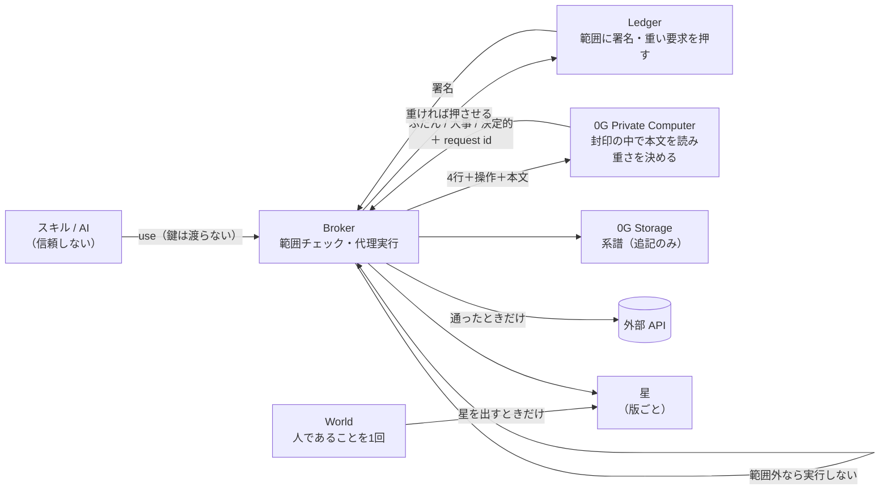

# アーキテクチャ v3（2026-11-06 朝・**実装に合わせて書き直した**）

> v2（`2026-11-06-architecture.md`）は、捨てたもの（M5Stick・スタックチャン・ENS・ViolationRegistry）が
> 図に残っていて、0G の役割も「返答を読んで警告する」古いままだった。**v3 がいまの正。**
> **動いているものと、まだのものを分けて書く。**

---

## 1. 一文

**AI が鍵を持たずに鍵を使える。範囲は手元の機器で署名し、重さは封印された AI が決め、
外れた要求は実行される前に止まって証拠が残る。**

## 2. 1回の使用で、何が順に起きるか

```
① スキルが use を投げる          （鍵は渡らない。要求にはスキル自身の署名が付く）
② Broker が範囲と突き合わせる    → 外れていれば   ✗ DENIED       実行しない・違反として刻む
③ 0G が要求の本文を読んで重さを決める → 届かなければ ✗ STOPPED      判断を作らない（safe-stop）
④ 重ければ手元の一押しを要求する  → 押さなければ   ✗ NEEDS_PRESS  鍵は使われない
⑤ Broker が代理で API を叩く      → 通った         ✓ ALLOWED      返答のハッシュを添えて刻む
⑥ 系譜を 0G Storage に置く        （root hash が出る。本文も鍵も入れない）
```

**別の線として、星を出すときだけ World を通る。**

```
⑦ 星を出す（＝この版を使っていると名乗る）
   → World で「人であること・同じ人であること」を1回だけ確かめる
   → 断られた            ✗ human_denied    星は出ない
   → 期限が切れた        ✗ proof_expired   星は出ない
   → 確かめられた        ✓ STAR            版ごとに1人1つ
```

## 3. 拒否が4種類あることが、この設計の中身

**「止まりました」を一語で済ませない。止まり方が違えば、責任の所在が違う。**

| | 誰が止めたか | 何を意味するか | どこで |
|---|---|---|---|
| `DENIED` | **本人が前もって引いた線** | 宣言した範囲を外れた要求。**スキルの署名ごと刻む** | Broker（`src/scope.js`） |
| `STOPPED` | **誰も止めていない。決められない** | 0G に届かず重さが決まらない。**決めずに通すことをしない** | Broker（`src/weigh.js`） |
| `NEEDS_PRESS` | **いま、人がまだ押していない** | 重い要求。立っている許可では通さない | Broker（`src/tier.js`） |
| `human_denied` / `proof_expired` | **人が断った / 人が居なかった** | 星を出さない。断ったことも残る | World（`src/world.js`） |

## 4. 部品（**いま動いているものだけ太字**）

| 置き場 | 部品 | 持つもの | 状態 |
|---|---|---|---|
| 手元 | **Ledger（自作アプリ）** | 元鍵 | **実機で動作**（minta／`minta/ledger-app`）。digest は端末内で計算 |
| 手元 | **Broker** | 子トークン・系譜 | **動く**（`broker/`・試験50件）。**ここが唯一の信頼点** |
| 外 | **0G Private Computer（TeeML）** | 要求の本文（封印の中） | **配線済み**。API キー待ち（`0gm-1.0-35b-a3b`・tee_attested） |
| 外 | **0G Storage（Log層）** | 系譜 | **配線済み。** tx が組み上がるまで実測。gas 待ち（Flow `0x22E0…5296`） |
| 外 | **World（Agent Pass）** | 人であることの証明 | **配線済み**。クライアント登録待ち（OIDC device flow） |
| 画面 | 星空・記録 | — | minta が実装中 |
| チェーン | VouchRegistry | 星 | **出していない。** 星は Broker の追記ログにある。`verifyingContract` は 0x0 で凍結 |
| — | Anon-RPC | 星の読み取り | **設計のみ**（EF・#6 の判定次第） |

## 5. 誰が何を知るか（**設計で分けてある**）

| | 知っている | 知らない |
|---|---|---|
| Ledger | 範囲の4行・押したかどうか | 要求の本文 |
| World | 人であること・同じ人であること（仮名） | 何に星を出したか・何の鍵か |
| 0G（TeeML） | **要求の本文**（封印の中で） | 鍵の平文。**我々も読めない** |
| Broker | 範囲・判定・系譜 | — **信頼点。今回は TEE に載っていない** |
| 系譜（公開） | 誰が許し、何を要求し、通ったか止まったか | 本文も鍵も入れない |

## 6. 図



## 7. 限界（**黙って良く見せない**）

- **Broker が鍵を持つ。信頼点はここ1点。** 本番は Broker ごと 0G Private Computer に載せるのが筋。今回は載せていない
- **星はチェーンに出していない。** Broker の追記ログにある。VouchRegistry 未デプロイ
- **模擬モードがある**（`ZG_OFFLINE` / `WORLD_OFFLINE`）。記録に `simulated: true` が残る。**撮影では外す**
- 版の照合（`version` が変わったときの自動消灯）は、星の読み取り側でのみ成立。Broker は `version` を見ていない
