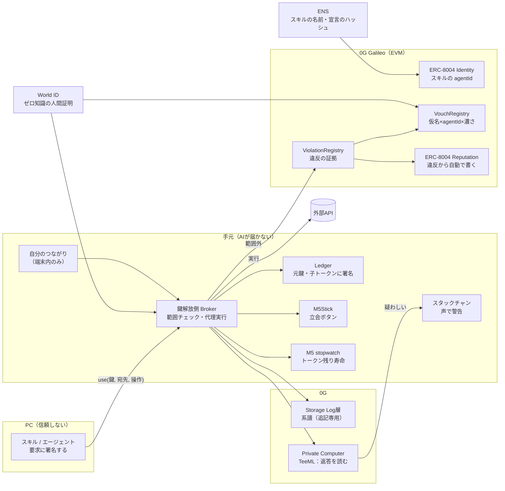

# アーキテクチャ（叩き台 v2）— 2026-11-06

> **【古い】2026-11-06 朝に `2026-11-06-architecture-v3.md` に置き換えた。**
> v2 の図には、捨てたもの（M5Stick・スタックチャン・ENS・ViolationRegistry）が残っている。
> **いまの正は v3。** ここは経緯として残す。

> v2: HW は **Ledger に絞る**。他の機器は「アレンジ（任意）」。Broker の位置付けを追記。図は `2026-11-06-architecture-v2.html`（ブラウザで開く）

> 統合版（`2026-11-06-integrated.md`）の仕組みを、部品と流れに落としたもの。
> **未決・未確認には印を付けた。** 推測で埋めていない。

## 0. 原則（ここから外れる設計はしない）
1. **元鍵は PC に置かない。** PC の上のAI（スキル・エージェント）は信頼しない前提
2. **証明できる裏切りだけを罰し、疑わしいものは知らせるだけ**
3. **人間の情報は持たない。** 事業者に渡るのはゼロ知識の証明と仮名だけ
4. **「誰が自分の知り合いか」は手元から出さない。** 評判は見る人の端末で計算する

## 1. 全体図

## 2. 部品

### 手元（AIが届かない側）
| 部品 | 持つもの | やること |
|---|---|---|
| **Ledger** | 元鍵 | 子トークンに EIP-712 で署名。**範囲（鍵・宛先・回数・期限）が Ledger の画面に出る** ※EIP-712 の表示形式は要確認 |
| **Broker（鍵解放側）** | 子トークン・宣言 | 要求と範囲を突き合わせる／範囲内なら**自分で API を叩く**（平文は PC を通らない）／系譜を書く ※**どの機械で動かすか未決**（PC の外であること） |
| **（Ledger）立会** | — | 危ない使用は Ledger の画面で範囲を見て、ボタンで承認。承認しなければ拒否 |
| **アレンジ（任意）** | — | 通知や立会ができる機器なら何でも足せる。例: M5Stick（立会）／スタックチャン（声で警告）／時計（トークンの残り寿命） |
| **自分のつながり** | 知り合いの仮名と濃さ | **端末の外に出さない。** 評判の計算はここで |

### チェーン（0G Galileo。EVM）
| コントラクト | 中身 |
|---|---|
| ERC-8004 Identity（**既存・デプロイ済み** `0x8004A818…`） | スキルの agentId。agentWallet＝要求に署名する鍵 |
| ERC-8004 Reputation（**既存** `0x8004B663…`） | 人が書かない。**違反から自動で書く**だけ |
| **VouchRegistry（新規）** | `(nullifier, agentId, 濃さ, VCハッシュ)`。1人1AIに1票をここで守る |
| **ViolationRegistry（新規）** | 範囲外の要求（スキルの署名付き）＋子トークン。誰でも検証できる証拠 |

### 外部
| 部品 | 役 |
|---|---|
| **World ID** | ①使用の瞬間の人間証明 ②保証人の仮名。※会場は mock proof |
| **ENS** | スキルの名前（例 `weather.skills.<x>.eth`）。text record に agentId と宣言のハッシュ |
| **0G Storage** | 系譜（Log層・追記専用）。root hash を提出物に出す |
| **0G Private Computer** | 返ってきた中身を TeeML のモデルが読み、疑わしければ知らせる。request ID を系譜に入れる |

## 3. 4つの流れ

### A. スキルの登録
1. 開発者が ERC-8004 Identity に登録 → agentId
2. **宣言**（使う鍵・宛先・回数・期限）のハッシュを ENS の text record に置く

### B. 保証する（人 → AI）
1. 保証人が World ID の証明を出す。**action = `vouch`（固定）**、signal = `hash(agentId, 濃さ)`
2. 証明から出る nullifier が**アプリ内で固定の仮名**になる（実名には結びつかない）
3. VouchRegistry に `(nullifier, agentId, 濃さ)`。同じ組は1回だけ
4. 書式は VC（W3C Verifiable Credentials）に合わせ、ハッシュを置く。**VC は運ぶだけ。重みと罰はチェーン**

**仮名と知り合いの対応づけ**: 会ったときに仮名を交換する（M5 同士・QR 等。叩き台）。
交換した記録が「会った」の根拠になり、**端末の中だけ**に残る。

### C. 使う（正常系）
1. スキルが `use(鍵, 宛先, 操作)` を署名付きで Broker に送る
2. Broker が手元で重みを計算：VouchRegistry のうち、**自分のつながりにある仮名**の保証だけを濃さで足す
3. 重み → 子トークンの太さ。Ledger が署名（範囲が画面に出る）。stopwatch に寿命
4. 危ない操作なら：World ID（signal = 要求のハッシュ）＋ M5Stick の立会
5. Broker が API を実行 → 返却データのハッシュに署名
6. 系譜を 0G Storage へ（下の5点を同じ要求ハッシュでつなぐ）
7. TeeML が返答を読む → 疑わしければスタックチャンが警告（**重みは動かさない**）

**系譜の5点**: ①nullifier（誰が許した）②子トークン（何を・どこへ・いつまで）③実行した呼び出し ④返却ハッシュ＋署名（内容証明）⑤TeeML の request ID

### D. 違反（範囲外の要求）
1. Broker が範囲外を検出 → 拒否
2. **スキルの署名付き要求＋子トークン**を ViolationRegistry へ。誰でも「範囲外だった」と検証できる
3. 自動で：スキルに違反の印／ERC-8004 Reputation に負の記録／**保証していた仮名の重みが下がる**
4. その仮名が保証していた他のスキルは、次から子トークンが細くなる

## 4. 何を、どこに置くか
| データ | 置き場所 | 理由 |
|---|---|---|
| 元鍵 | Ledger | AIが届かない |
| 平文の API キー | Broker の中だけ | PC を通さない |
| 自分のつながり | 自分の端末 | 外に出す理由がない |
| 保証（仮名×AI×濃さ） | 0G チェーン | 誰でも数えられる必要がある |
| 違反の証拠 | 0G チェーン | 誰でも検証できる必要がある |
| 系譜の本体 | 0G Storage | 量が多い。root hash だけチェーンへ |
| 人間の名前・顔 | **どこにも置かない** | ゼロ知識証明だけ |

## 5. ゼロ知識をどこに使うか
- **使う**: ①使用の瞬間の人間証明 ②保証人の仮名 — どちらも World ID の流用で、新しく作らない
- **使わない**: 「知り合いが何人保証しているか」— 見る人が手元で計算すれば済む
- **36時間では作らない**: API 応答の内容証明（zkTLS）→ 自前署名で代える／AI の判断の証明（zkML）→ TeeML で代える

## 6. スポンサーへの写り方
| 社 | どこに出るか | 提出物 |
|---|---|---|
| World | B-1（保証）／C-4（立会）／**D（拒否パス）** | Agent Pass の統合＋拒否の実演 |
| ENS | A-2（スキルの名前と宣言） | ENSv2 の利用 |
| 0G | Storage の系譜／TeeML／ERC-8004（Galileo）／実機 | request ID・root hash・コントラクトアドレス |

## 6.5 Broker の位置付け（提案・未合意）
- **サービスとして提供する。ただし Broker 単独では鍵を開けない。** 鍵（DEK）を 2-of-2 に割り、片方は Ledger、片方は Broker
- 運営者でも単独では平文を見られない → 「事業者は持たない」が守れる
- 提供者はスキル市場の運営者など。**B2B の「信用の層」の本体**になる
- 端末内（PC の別プロセス）は不可: PC の上のAIから届く。別端末は一般の人には重い
- 36時間のデモ: 片方の PC を「サービス側」に見立てて動かす。本番は TEE に載せる（TEE の提供元は未調査）

## 7. 未決・未確認
- Broker: 上の提案（サービス＋2-of-2）で合意するか
- Ledger の EIP-712 表示で、範囲がどこまで読める形で出るか
- 子トークンの方式：Ledger で都度署名か、Macaroon / UCAN 型の減衰か
- World ID の nullifier を action 固定で仮名として使う設計が、Agent Pass / IDKit の規約・API で成り立つか
- ENSv2 のチェーンと 0G Galileo の行き来（text record で参照する想定）
- 重みの式（濃さ3段の点数・違反でどれだけ下げるか）
- 仮名を交換する手段（QR が基本。機器を足すアレンジもあり）
