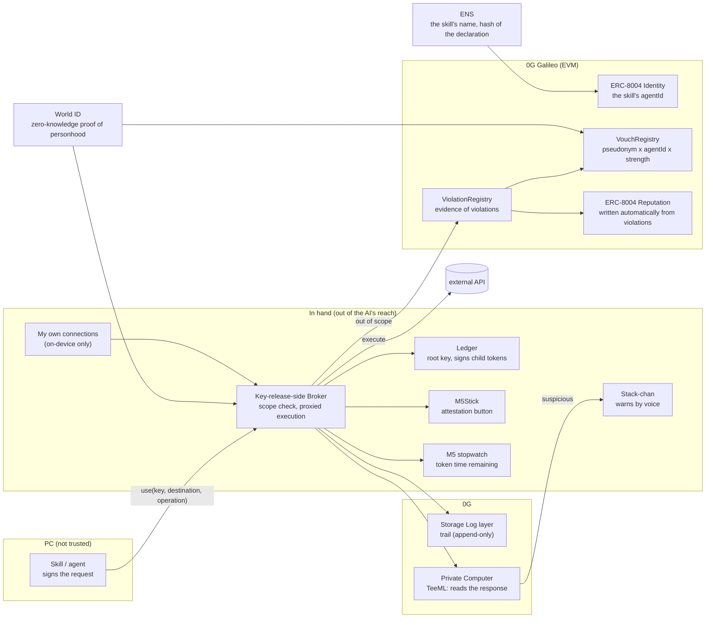

# Architecture (draft v2) — 2026-11-06

> **[OUTDATED] Replaced by `2026-11-06-architecture-v3.md` on the morning of 2026-11-06.**
> The v2 diagram still contains things we threw away (M5Stick, Stack-chan, ENS, ViolationRegistry).
> **v3 is the current truth.** This is kept as a record of how we got here.

> v2: for hardware, **narrow down to the Ledger**. Other devices are "optional add-ons." Added a note on where the Broker sits. The diagram is `2026-11-06-architecture-v2.html` (open it in a browser)

> This takes the mechanism from the integrated version (`2026-11-06-integrated.md`) and breaks it down into parts and flows.
> **Undecided and unverified items are marked.** Nothing is filled in by guesswork.

## 0. Principles (no design departs from these)
1. **The root key is not kept on the PC.** We assume the AI on the PC (skills, agents) is not trusted
2. **Punish only provable betrayal; for anything merely suspicious, just notify**
3. **Hold no human information.** What reaches the operator is only a zero-knowledge proof and a pseudonym
4. **"Who my acquaintances are" never leaves the device.** Reputation is computed on the viewer's device

## 1. Overall diagram

## 2. Parts

### In hand (the side the AI cannot reach)
| Part | What it holds | What it does |
|---|---|---|
| **Ledger** | The root key | Signs child tokens with EIP-712. **The scope (key, destination, call budget, expiry) appears on the Ledger's screen** ※the EIP-712 display format needs checking |
| **Broker (key-release side)** | Child tokens, declarations | Checks the request against the scope / if within scope, **calls the API itself** (plaintext never passes through the PC) / writes the trail ※**which machine it runs on is undecided** (it must be outside the PC) |
| **(Ledger) attestation** | — | For dangerous uses, look at the scope on the Ledger's screen and approve with a button. Without approval, it is refused |
| **Optional add-ons** | — | Any device that can notify or attest can be added. Examples: M5Stick (attestation) / Stack-chan (warns by voice) / a watch (token time remaining) |
| **My own connections** | Acquaintances' pseudonyms and strengths | **Never leaves the device.** Reputation is computed here |

### Chain (0G Galileo. EVM)
| Contract | Contents |
|---|---|
| ERC-8004 Identity (**existing, already deployed** `0x8004A818…`) | The skill's agentId. agentWallet = the key that signs requests |
| ERC-8004 Reputation (**existing** `0x8004B663…`) | Humans do not write to it. **Only written automatically from violations** |
| **VouchRegistry (new)** | `(nullifier, agentId, strength, VC hash)`. One vote per person per AI is enforced here |
| **ViolationRegistry (new)** | Out-of-scope requests (with the skill's signature) plus the child token. Evidence anyone can verify |

### External
| Part | Role |
|---|---|
| **World ID** | (1) proof of personhood at the moment of use (2) the voucher's pseudonym. ※at the venue it is a mock proof |
| **ENS** | The skill's name (e.g. `weather.skills.<x>.eth`). agentId and the hash of the declaration in a text record |
| **0G Storage** | The trail (Log layer, append-only). The root hash goes into the submission |
| **0G Private Computer** | A TeeML model reads the returned content and notifies if it is suspicious. The request ID goes into the trail |

## 3. Four flows

### A. Registering a skill
1. The developer registers in ERC-8004 Identity → agentId
2. Put the hash of the **declaration** (keys used, destinations, call budget, expiry) in an ENS text record

### B. Vouching (person → AI)
1. The voucher produces a World ID proof. **action = `vouch` (fixed)**, signal = `hash(agentId, strength)`
2. The nullifier derived from the proof becomes **a pseudonym that is fixed within the app** (it is not linked to a real name)
3. `(nullifier, agentId, strength)` goes into VouchRegistry. The same pair only once
4. The format follows VC (W3C Verifiable Credentials), and the hash is placed on chain. **The VC only carries; the weight and the penalty are on chain**

**Mapping pseudonyms to acquaintances**: exchange pseudonyms when you meet (between M5s, by QR, etc. Draft).
The record of the exchange is what grounds "we met," and it stays **only inside the device**.

### C. Using it (the normal path)
1. The skill sends `use(key, destination, operation)` to the Broker with a signature
2. The Broker computes the weight locally: among the vouches in VouchRegistry, it sums only those from **pseudonyms in its own connections**, by strength
3. Weight → the thickness of the child token. The Ledger signs (the scope appears on the screen). The stopwatch gets the lifetime
4. For a dangerous operation: World ID (signal = hash of the request) + M5Stick attestation
5. The Broker executes the API → signs the hash of the returned data
6. The trail goes to 0G Storage (the five items below are linked by the same request hash)
7. TeeML reads the response → if suspicious, Stack-chan warns (**the weight does not move**)

**The five items in the trail**: (1) nullifier (who permitted it) (2) the child token (what, to where, until when) (3) the call that was executed (4) the returned hash plus a signature (proof of content) (5) the TeeML request ID

### D. Violation (an out-of-scope request)
1. The Broker detects out-of-scope → refuses
2. **The signed request from the skill plus the child token** go to ViolationRegistry. Anyone can verify that it was out of scope
3. Automatically: a violation mark on the skill / a negative record in ERC-8004 Reputation / **the weight of the pseudonyms that vouched for it goes down**
4. Other skills that pseudonym vouched for get thinner child tokens from then on

## 4. What goes where
| Data | Location | Reason |
|---|---|---|
| The root key | Ledger | Out of the AI's reach |
| API keys in plaintext | Only inside the Broker | Does not pass through the PC |
| My own connections | My own device | No reason to let it out |
| Vouches (pseudonym x AI x strength) | 0G chain | Anyone needs to be able to count them |
| Evidence of violations | 0G chain | Anyone needs to be able to verify it |
| The body of the trail | 0G Storage | It is large. Only the root hash goes on chain |
| Human names and faces | **Nowhere** | Zero-knowledge proofs only |

## 5. Where zero-knowledge is used
- **Used**: (1) proof of personhood at the moment of use (2) the voucher's pseudonym — both reuse World ID; we build nothing new
- **Not used**: "how many acquaintances have vouched" — the viewer can compute it locally
- **Not building in 36 hours**: proof of API response content (zkTLS) → replaced with our own signature / proof of the AI's judgment (zkML) → replaced with TeeML

## 6. How it looks to sponsors
| Company | Where it appears | Submission |
|---|---|---|
| World | B-1 (vouching) / C-4 (attestation) / **D (the refusal path)** | Agent Pass integration plus a live demonstration of refusal |
| ENS | A-2 (the skill's name and declaration) | Use of ENSv2 |
| 0G | The trail in Storage / TeeML / ERC-8004 (Galileo) / the real device | Request ID, root hash, contract addresses |

## 6.5 Where the Broker sits (proposal, not agreed)
- **Offer it as a service. But the Broker alone cannot open the key.** Split the key (DEK) 2-of-2: one half on the Ledger, one half on the Broker
- Even the operator cannot see plaintext alone → "the operator does not hold it" holds
- Providers would be skill marketplace operators and the like. **This becomes the core of the B2B "trust layer"**
- On-device (a separate process on the PC) is not acceptable: the AI on the PC can reach it. A separate device is heavy for ordinary people
- The 36-hour demo: use a second PC as a stand-in for "the service side." In production it runs in a TEE (the TEE provider has not been researched)

## 7. Undecided and unverified
- Broker: whether we agree on the proposal above (service + 2-of-2)
- How much of the scope is actually readable in the Ledger's EIP-712 display
- The child token scheme: signing on the Ledger each time, or Macaroon / UCAN-style attenuation
- Whether the design of using a World ID nullifier with a fixed action as a pseudonym holds under the Agent Pass / IDKit terms and API
- Moving between the ENSv2 chain and 0G Galileo (assumed to be referenced via a text record)
- The weight formula (points for the three strength tiers, how far a violation drops it)
- The means of exchanging pseudonyms (QR as the base. Add-on devices are also an option)
