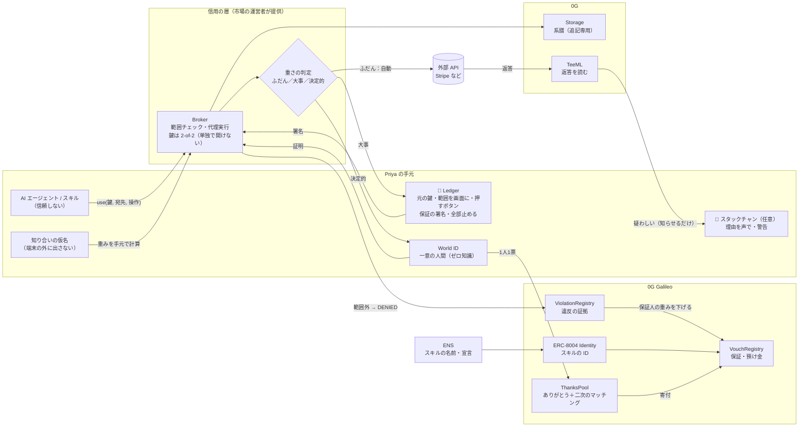
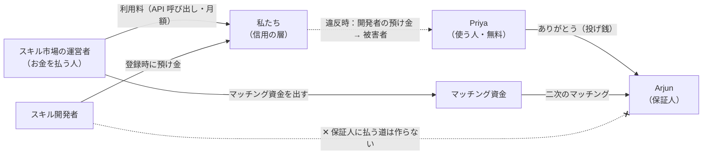

# 仕上がりのイメージ — アーキテクチャ・ビジネスモデル・ペルソナ・ジャーニー（2026-11-06）

> 提出動画の絵コンテになるように書いた叩き台。印：**[合意]** ／ **[提案]** ／ **[未確認]**
> 考え方は `2026-11-06-philosophy.md`、機能の詳細は `2026-11-06-review.md`。
>
> **【この文書の 1 章と 2 章は 2026-11-06 未明より前の版】** 預け金（VouchRegistry）・ありがとう（ThanksPool）・二次のマッチング・保険料は、**決定1で捨てた**。いま賭けているのは「自分の鍵そのもの」で、**製品の中で金は1円も動かない**。最新の入出力は `2026-11-06-actors-io.html`、収益は `2026-11-06-market-and-model.html`。

---

## 1. アーキテクチャ（仕上がり）

**読み方**
- **左（Priya の手元）**：AI が届かないものだけを置く。主役は Ledger [合意]。スタックチャンは時間があれば足す [合意]
- **真ん中（信用の層）**：運営者が提供するサービス。ただし鍵は 2-of-2 なので、運営者でも単独では開けない [提案]
- **右（チェーン）**：保証・違反・ありがとうを、誰でも検証できる形で置く
- **重さの判定**：ほとんどの要求は「ふだん」なので、人は何もしない。人と機器が出てくるのは大事なときだけ [提案]

---

## 2. ビジネスモデル [提案]

### お金の流れ

| 誰 | 払う／得る | なぜそうするか |
|---|---|---|
| **運営者（顧客）** | 利用料とマッチング資金を**払う** | 野良スキルの事故は、市場の信用を壊す（ClawHub では 2,857 件中 341 件が悪性）。良い保証が増えるほど事故が減る |
| **Priya（使う人）** | **無料**。払いたければ「ありがとう」を送る | 使う人に払わせると、雑な管理の人ほど入ってこない |
| **Arjun（保証人）** | ありがとうとマッチングを**得る**。自分の預け金は賭け金になる | 見る目が当たったときだけ報われる |
| **開発者** | 登録時に預け金を**置く**。違反すれば被害者に回る | 範囲を宣言するのは開発者自身。破ったときの責任も開発者に置く |
| **私たち** | 利用料を**得る** | 寄付からは手数料を取らない（贈与を濁さない）[提案] |

### 顧客が買うもの
「**この市場のスキルは、範囲外の要求をすれば止まり、証拠が残る**」という保証です。市場の運営者にとっては差別化になり、事故が起きたときに説明する材料にもなります。

### まだ決めていないこと
- 利用料の単位（呼び出しごとか、月額か）と価格。**数字は1つも検証していない** [未確認]
- Broker を TEE に載せる提供元 [未確認]
- 寄付から手数料を取らないで回るか

---

## 3. ペルソナ（動画の登場人物）[提案]

### Priya（主役・使う人）
- **一言**：「AI に仕事を任せたいだけ。鍵の管理なんてしたくない」
- 30歳、小さなオンラインショップの経営者。エンジニアではない
- AI アシスタントに Stripe とメールのキーを貼り、スキルは星の数で入れている
- **怖いこと**：知らないうちにお客さんのデータが抜かれていること。起きても気づけないこと
- **持っているもの**：Ledger（暗号資産用に買った）。World ID
- **価値の瞬間**：AI が勝手に動こうとしたとき、机の上の Ledger が止めてくれる

### Arjun（保証人）
- **一言**：「良いものは勧めたい。でも、勧めて裏切られたら嫌だ」
- 32歳、開発者。友人たちから「どのスキルがいい？」とよく聞かれる
- **動機**：知見を寄付したい。見る目が当たっていることを、証拠付きで示したい
- **怖いこと**：勧めたものが悪さをして、友人の信頼を失うこと
- **価値の瞬間**：ありがとうが届く。そして、異変が起きたら最初に知れる

### Meera（顧客・市場の運営者）
- **一言**：「うちの市場の野良スキルで事故が起きたら、終わりだ」
- 38歳、AI スキル市場の信頼・安全の責任者
- **今の悩み**：審査をすり抜ける悪性スキルを止められない。星の評価は偽装される
- **価値の瞬間**：事故が起きても止まり、証拠が残り、誰の責任かを説明できる

---

## 4. カスタマージャーニー＝動画の絵コンテ [提案]

> 動画の長さは数分の想定（ETHGlobal の上限は [未確認]）。3幕構成：**AI はもう PC の中にいる → AI が押せないボタン → 押した記録が信頼になる**

| # | 場面 | Priya の気持ち | 画面・実機に映るもの | ナレーション／字幕 |
|---|---|---|---|---|
| 0 | **掴み** | 何も知らない | AI エージェントが `.env` を開き、画面の「許可」を一瞬で連打して通る | 「AI はもう、あなたの PC の中にいる」 |
| 1 | **選ぶ** | どれが安全か分からない | スキル一覧。星の数ではなく「Arjun さんが保証（一緒に働いた）」 | 「星の数ではなく、誰の星か」 |
| 2 | **入れる** | 面倒は嫌 | Ledger の画面に「Stripe 読み取り 5回・1時間／保証している知り合い 3人」。1回押す | 「鍵は Ledger から出ない」 |
| 3 | **日常** | 何も意識しない | AI が自動で注文を処理している。Ledger は静か | 「ふだんは、何もしなくていい」 |
| 4 | **事故の日（山場）** | ヒヤッとする | 野良スキルが範囲外を要求 → AI が「許可」を押そうとするが、Ledger の前で止まる → `DENIED`。（任意）スタックチャンが「このスキル、宣言してない宛先に送ろうとしてるよ」 | 「**AI は1秒に100回『許可』を押せる。このボタンだけは押せない**」 |
| 5 | **波及** | 自分だけの話じゃなかった | 信頼の網に赤い波。違反の証拠 → Arjun の重みが下がる → Arjun が保証した他のスキルの線も細くなる。Arjun のスマホに最初に通知 | 「裏切りは、保証した人にも刻まれる」 |
| 6 | **確かめる** | 信じられる | 審査員／視聴者が系譜をたどる（誰が許した → 何を → 何が返った）。0G の root hash | 「誰にも消せない」 |
| 7 | **ありがとう** | 守られた | Priya が World ID で Arjun に「ありがとう」を送る。たくさんの人から少しずつ届き、二次のマッチングで太くなる | 「保証は、売るものではなく贈るもの」 |

### Arjun のジャーニー（動画では 5 と 7 に挟み込む）
1. **保証する**：使って良かったスキルに、Ledger＋World ID で保証を出す（決定的な操作なので両方）
2. **ありがとうが届く**：守られた人から少しずつ届く。違反の無い保証が「目利きの履歴書」として積み上がる
3. **異変を知る**：自分が保証したスキルが範囲外を要求した、と最初に通知が来る
4. **取り下げる**：自分の記録を見て、保証を取り下げる

### Meera のジャーニー（動画の最後に1カットだけ）
- 自分の市場の管理画面：「今月、範囲外の要求 12件を停止。証拠あり」
- ここで、お金を払う理由を見せる

---

## 5. 動画で外さないこと
- **山場は 4 の「事故の日」**。止まったことを、成功したときと同じ重さで見せる
- **実機を映す**：Ledger の画面とボタンを、手元のアップで撮る
- **何もしない場面（3）を入れる**：安全なのに面倒ではない、ということは見せないと伝わらない
- スタックチャンは任意。間に合わなければ、4 の字幕で代える
