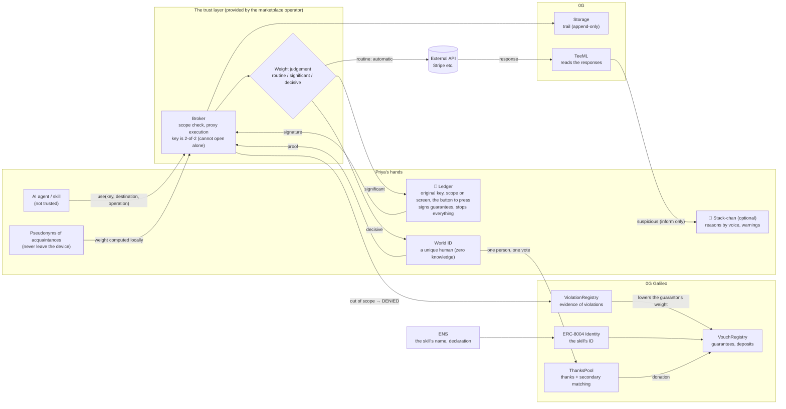
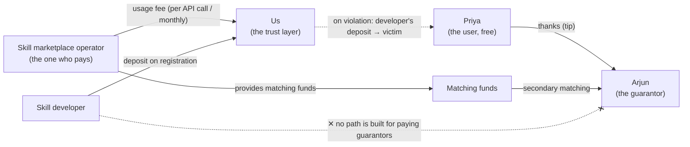

# The finished picture — architecture, business model, personas, journey (2026-11-06)

> A first draft written so it can serve as the storyboard for the submission video. Markers: **[agreed]** / **[proposed]** / **[unverified]**
> The thinking is in `2026-11-06-philosophy.md`; the feature details are in `2026-11-06-review.md`.
>
> **[Chapters 1 and 2 of this document are from before the early hours of 2026-11-06.]** The deposit (VouchRegistry), thanks (ThanksPool), secondary matching, and the insurance premium were **dropped in Decision 1**. What is staked now is "your own key itself", and **not one yen moves inside the product**. The latest inputs and outputs are in `2026-11-06-actors-io.html`; revenue is in `2026-11-06-market-and-model.html`.

---

## 1. Architecture (finished state)

**How to read it**
- **Left (Priya's hands)**: only the things the AI cannot reach are placed here. The Ledger is the lead [agreed]. Stack-chan is added if there is time [agreed]
- **Middle (the trust layer)**: a service provided by the operator. But the key is 2-of-2, so not even the operator can open it alone [proposed]
- **Right (the chain)**: guarantees, violations and thanks are placed in a form anyone can verify
- **Weight judgement**: most requests are "routine", so the person does nothing. People and devices only appear when it is significant [proposed]

---

## 2. Business model [proposed]

### The flow of money

| Who | Pays / receives | Why they do it |
|---|---|---|
| **Operator (the customer)** | **Pays** the usage fee and the matching funds | An incident with a stray skill destroys the marketplace's credibility (on ClawHub, 341 of 2,857 were malicious). The more good guarantees there are, the fewer incidents |
| **Priya (the user)** | **Free**. Sends "thanks" if she wants to pay | Make users pay and the ones with sloppy management are exactly the ones who won't come in |
| **Arjun (the guarantor)** | **Receives** thanks and matching. His own deposit becomes the stake | He is rewarded only when his judgement was right |
| **Developer** | **Puts up** a deposit on registration. It goes to the victims on a violation | The developer is the one who declares the scope. The responsibility for breaking it is also placed on the developer |
| **Us** | **Receive** the usage fee | We take no fee out of the donations (don't muddy a gift) [proposed] |

### What the customer buys
The guarantee that "**skills in this marketplace stop if they request something out of scope, and evidence remains**". For the marketplace operator this is a differentiator, and it is also material for explaining an incident when one happens.

### Not yet decided
- The unit of the usage fee (per call or monthly) and the price. **Not one number has been verified** [unverified]
- The provider for putting the Broker in a TEE [unverified]
- Whether it works without taking a fee out of the donations

---

## 3. Personas (the cast of the video) [proposed]

### Priya (protagonist, the user)
- **In one line**: "I just want to hand work to the AI. I don't want to manage keys"
- 30, runs a small online shop. Not an engineer
- Pastes her Stripe and email keys into the AI assistant, and installs skills by star count
- **What she fears**: customer data being siphoned without her knowing. Not noticing even when it happens
- **What she has**: a Ledger (bought for crypto). A World ID
- **The moment of value**: when the AI tries to act on its own, the Ledger on the desk stops it

### Arjun (the guarantor)
- **In one line**: "I want to recommend good things. But I don't want to be betrayed after recommending them"
- 32, a developer. Friends often ask him "which skill is good?"
- **Motivation**: he wants to donate his expertise. He wants to show, with evidence, that his judgement is right
- **What he fears**: something he recommended doing harm and losing his friends' trust
- **The moment of value**: thanks arrives. And when something goes wrong, he learns about it first

### Meera (the customer, the marketplace operator)
- **In one line**: "If an incident happens with a stray skill in our marketplace, we're finished"
- 38, head of trust and safety at an AI skill marketplace
- **Her current problem**: she cannot stop malicious skills that slip past review. Star ratings are faked
- **The moment of value**: even when an incident happens, it stops, evidence remains, and she can explain whose responsibility it was

---

## 4. Customer journey = the video's storyboard [proposed]

> The video length is assumed to be a few minutes (ETHGlobal's limit is [unverified]). Three acts: **the AI is already inside your PC → a button the AI cannot press → the record of pressing becomes trust**

| # | Scene | What Priya feels | What appears on screen / on the device | Narration / subtitle |
|---|---|---|---|---|
| 0 | **Hook** | She knows nothing | The AI agent opens `.env`, hammers the on-screen "allow" in an instant, and gets through | "The AI is already inside your PC" |
| 1 | **Choosing** | She can't tell which is safe | A list of skills. Not the star count but "guaranteed by Arjun (worked together)" | "Not the number of stars, but whose star it is" |
| 2 | **Installing** | She doesn't want hassle | The Ledger screen shows "Stripe read, 5 calls, 1 hour / 3 acquaintances guaranteeing". One press | "The key never leaves the Ledger" |
| 3 | **Routine** | She doesn't think about it | The AI processes orders automatically. The Ledger is quiet | "In routine use, you don't have to do anything" |
| 4 | **The day of the accident (climax)** | A jolt of fear | A stray skill requests something out of scope → the AI tries to press "allow" but is stopped in front of the Ledger → `DENIED`. (Optional) Stack-chan says "this skill is trying to send to a destination it never declared" | "**An AI can press 'allow' 100 times a second. This is the one button it cannot press**" |
| 5 | **Ripple** | It wasn't just about her | A red wave across the web of trust. Evidence of the violation → Arjun's weight drops → the lines to the other skills Arjun guaranteed get thinner too. Arjun's phone is notified first | "Betrayal is inscribed on the person who guaranteed it too" |
| 6 | **Verifying** | She can believe it | The judges / viewers trace the trail (who permitted → what → what came back). 0G's root hash | "No one can erase it" |
| 7 | **Thanks** | She was protected | Priya sends "thanks" to Arjun with World ID. A little arrives from many people, and secondary matching thickens it | "A guarantee is not sold, it is given" |

### Arjun's journey (interleaved at 5 and 7 in the video)
1. **Guaranteeing**: he issues a guarantee for a skill he used and liked, with Ledger + World ID (both, since it is a decisive operation)
2. **Thanks arrives**: a little at a time from the people it protected. Guarantees with no violations pile up as a "résumé of judgement"
3. **Learning of the anomaly**: he is the first to be notified that a skill he guaranteed requested something out of scope
4. **Withdrawing**: he looks at his own record and withdraws the guarantee

### Meera's journey (just one cut at the end of the video)
- Her marketplace's admin screen: "This month, 12 out-of-scope requests stopped. Evidence available"
- This is where we show the reason to pay

---

## 5. What the video must not miss
- **The climax is 4, "the day of the accident"**. Show the stop with the same weight as a success
- **Show the real device**: shoot the Ledger's screen and button close up, in hand
- **Include the scene where nothing happens (3)**: that it is safe and yet not a hassle doesn't come across unless you show it
- Stack-chan is optional. If it isn't ready, replace it with the subtitle at 4
