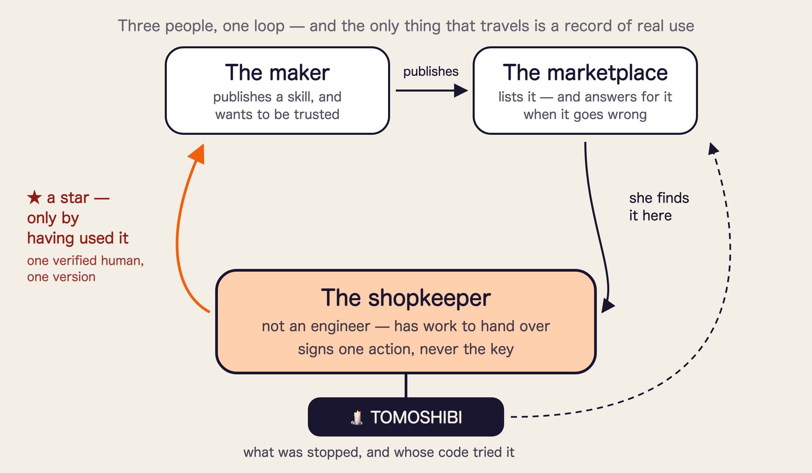

# ファイナリスト発表 — 3分スライドの骨子（日本語・参考訳）

> **正本は英語版 [`2026-11-07-finalist-slides.md`](2026-11-07-finalist-slides.md)。**
> これは読み合わせ用の参考です。食い違ったら英語版が正。
>
> **スライドは5枚。話の真ん中にはスライドが無い。製品が動いているから。**
> 一言一句の台本は `2026-11-07-finalist-4min.md`。**2:55 に着地**させ、5秒を余らせる。
>
> 審査は **Technicality / Originality / Practicality / Usability / WOW**。
> 「動くシステムを見せること」が最重要と言われているので、**実演を背骨にし、
> スライドには画面が語れないことだけを載せる。**

---

## 全体の形

| | 時間 | 画面 | 役割 |
|---|---|---|---|
| **S1** | 0:00–0:25 | **問題。**絵1枚と3行 | この部屋の全員がやったことがある |
| **S2** | 0:25–0:50 | **ビフォー／アフター**を1枚の絵で | 説明される前に、変化が目で分かる |
| **— 実演 —** | **0:50–2:10** | **スライド無し。製品** | Technicality・WOW・Usability |
| **S3** | 2:10–2:28 | **提供価値と、それを支える機能** | いま見たものが、なぜ自分に効くのかに繋がる |
| **S4** | 2:28–2:40 | **誰のためのもので、その人の何が変わるか** | Practicality |
| **S5** | 2:40–2:55 | **何のためのものか、誰が作ったか** | 審査員が最後に見ながら決める面 |

**合計 2:55。** 長押しは 1:20 に来る。そこを過ぎていれば、いつ切られても主張は出ている。

---

## S1 — 問題（0:00–0:25）

**スライド:** ロボットの手にテープで留められた鍵。**その後ろに、同じ鍵が何本も。** 下に短く3行。

> **上限なし。期限なし。領収書なし。**

**話す:** 「この中にも、今週 API キーを AI エージェントに貼った方がいるんじゃないでしょうか。
今朝かもしれません。その鍵には上限が無く、期限も無く、領収書も出ません。
クレジットカードをこんな渡し方は絶対にしない。
しかも1本では済みません。エージェントごと、スキルごと、サービスごとに1本ずつ増えていく。
**AI の時代が静かに僕たちに増やしたのは、プロンプトでもモデルでもなく、鍵の管理です。**
数も、置き場所も、持っているソフトの数も、誰も把握できていない。」

**このスライドに製品名は出さない。** 最初の25秒は問題のものです。

---

## S2 — ビフォー／アフター（0:25–0:50）

**1枚の絵を中央で割る。このスライドが主張を背負うので、2秒で読めること。**

| **灯火が無いとき** | **灯火があるとき** |
|---|---|
| 鍵は**エージェントの手の中** | 鍵は**ゲートの内側**。エージェントが持つのは札だけ |
| 矢印は全部通る | 多くは通り・1本は指待ち・1本は×で止まる |
| 下に: *上限なし・期限なし・記録なし* | 下に: *範囲・回数・期限・通した分も止めた分も記録* |

**絵の下に、名前と1文。**

> **TOMOSHIBI — 鍵を預かり、エージェントには一回分の承認済みの行為だけを渡す承認レイヤー。**
>
> **鍵は渡さない** → *漏れる鍵が、そもそもどこにも置かれていない*
> **重いときだけ聞く** → *邪魔にならないから、外されない。外されない安全策だけが守る*
> **止めたことが、誰が試したかごと残る** → *「知らない間に使われていた」が起きない*
>
> ### だから、仕事を丸ごと渡しても、取り返しのつかないことは起きない。

**話す:** 「鍵はこちらが預かります。エージェントが受け取るのは一回分の承認だけで、その承認は
エージェントが押せないハードウェアの上で署名されます。動かします。」

---

## 実演（0:50–2:10）— **スライドの枠は出したまま、右半分で製品を動かす**

**画面は左右に割り、実演のあいだずっと割ったまま。** 左は固定のリストで、
**「彼女が何をしようとしたか」と「灯火が何をもたらすか」**。右は実物が動いていて、
**Ledger も同じ画角に入れる。** いま実演している行だけを強調し、ほかは薄く。
**審査員が順番を覚える必要をなくす。**

**左パネル（実演中は一度も書き換えない）:**

| 彼女がしようとしたこと | 灯火がもたらすもの |
|---|---|
| *(口頭のみ)* その日の注文処理 | 何も聞かれない。鍵はエージェントに届いていない |
| **お客さんに返金する** | **押していない支払いは、起きない** |
| **入れたツールが別の宛先に行こうとする** | **「知らない間に使われていた」が起きない** |
| **そのツールが黙って更新される** | **古い評価が、新しいコードに引き継がれない** |
| **一週間を見返す** | **通した分も止めた分も、ひとつの記録で確かめられる** |

**このパネルに長押し・範囲・署名の話は一語も書かない。** それは右半分がやっていること。
左半分は、**なぜそれが欲しいのか**だけを書く。

**右半分、拍ごと（80秒）:**

| 行 | 目安 | 右に見えるもの | 一言 |
|---|---:|---|---|
| **返金** | 35秒 | `0G: significant` → 実機が書き換わり4行 → **長押し** → **1回だけ**通る | 「普段の読み取りは黙って通り、鍵はエージェントに届きません。これは金が動くので聞きます。AI は1秒に100回押せる。**これは押せない唯一のボタンです**」 |
| **別の宛先** | 20秒 | 範囲外の要求 → `DENIED`。**スキル自身の署名付きで記録** | 「実行される前に止まり、名前が残りました」 |
| **更新** — **World** | 15秒 | 版を上げる → 星が一斉に消える | 「ここでの星は約束ではなく事実です。本人確認された人が、実際にその版を使った証。版が変われば全部消えます」 |
| **一週間** — **0G** | 10秒 | 記録と、0G Storage の tx | 「通したものと止めたものが同じ記録に並び、チェーンに乗っています」 |

**「黙って通る」は見せずに口で言う** — 左の薄い1行目と、返金の拍の冒頭に入れてあります。
見せると10秒かかる上に、この系でいちばん驚きが薄い。

**実機が言うことを聞かないとき:** 話し続けて、同じ長押しを画面側で見せる。退避の段取りは
`2026-11-06-storyboard.md` の「Order of degradation」。**壇上でハードを直そうとしない。**

---

## S3 — 提供価値と、それを支える機能（2:10–2:28）

**4行。読ませるのは左だけ。右は「約束ではなく仕組みだ」と目で分かればいい。**

| その人が得るもの | それを作っているもの |
|---|---|
| **鍵はエージェントの外にある** | 秘密は送信の瞬間に差し替える。エージェントが持つのは札だけなので、文脈にもログにもスキルにも取れるものが無い |
| **支払いは、ボタンを押したときだけ実行される** | **0G** の封じたモデルが先に重さを測り、重いものだけ **Ledger** の長押しに回す。めったに聞かないから、切られずに使い続けられる |
| **使われたことは、全部あとから見える** | 追記のみの証跡。使用は1回1行で残り、範囲外の要求は**試した相手の署名ごと**残る |
| **実際に使っている人の評価が見える** | **World ID** で本人確認された人が、**まさにその版を実際に使った**ときだけ星を灯せる。版が変われば一斉に消える |

**話す:** 「4つとも、約束ではなく動いているものです。」

---

## S4 — 誰のためのもので、その人の何が変わるか（2:28–2:40）

**スライド: 絵1枚 — [`assets/trust-loop.png`](../assets/trust-loop.png)。3人、1つの輪。**

主人公は店主。あとの2人は、**彼女の選択が当てずっぽうでなくなる理由**として居ます。
**作り手**は配って、信用されたい。**マーケットプレイス**は並べて、事故の責任を負う。
**店主**は実際に使ったときだけ星を灯す。だから輪を回っていくのは、**実使用の記録だけ**です。

| | その人の何が変わるか |
|---|---|
| **エンジニアではない店主** | **管理しようのないものを持たずに**、仕事をエージェントに任せられる |
| **スキルを配る作り手** | 信用が、買える星の数ではなく**実際に使われた事実**から積まれる |
| **マーケットプレイス** | 野良スキルが何かしても、**何が止まり誰のコードが試したかを言える**。市場を閉じずに済む |

**スライド下端に小さく。聞かれなければ読み上げない:**

> 判定の従量と、灯の表示で課金。**動いた金額の%は取らない** — 止めるほど損をする会社に
> ならないため。

**話す:** 「これは鍵の管理ツールではありません。**仕事をエージェントに任せることを、普通の人が
引き受けられるようにする層**です。」

---

## S5 — 何のためのものか、誰が作ったか（2:40–2:55）

**スライド: 墨色の地に、大きく1行。その下にチーム。**

> # 仕事を渡す。鍵は渡さない。
>
> **エージェントに本物を任せることを、普通の人が引き受けられるようにする。**

**その下に、機能ではなく価値を3行:**

> **覚えない・保管しない・管理しない。署名した範囲を越えない。
> 何が起きても、あとから自分で説明できる。**

**同じ面にチーム:**

> ### チーム 余白（Yohaku）
> **minta** — 装置と、人が実際に目にするところ全部
> **kou** — ブローカーと、その下の3つの技術
>
> *2人、36時間、動いているシステム1つ。*

**話す:** 「エージェントごと、スキルごと、サービスごとに鍵が増えて、**管理が追いつかなく
なった**ところから作りました。何に使われたのかも見えない。**仕事を渡して、鍵は渡さない。**」

**「レビューの星は消えない、灯は消える」は締めから外し、Q&A の「何に着想を得たか」の答えに
移しました**（`2026-11-07-finalist-4min.md` §3）。単体では説明が要る言葉で、
**説明の要る締めは締めではない**ため。

---

## 審査5項目をどこで取るか

| | どこ |
|---|---|
| **Technicality** | 実機の長押しと、スキル署名付きの `DENIED` |
| **Originality** | 4種類の拒否を潰さないこと。そして消える星 |
| **Practicality** | S4 の3人と、実際に動いていること |
| **Usability** | 口で言う「黙って通る」と S3 の1行目。普段の日は何も聞かれない |
| **WOW** | 灯の拍。星が一斉に消える瞬間 |

---

## 3分に入れないと決めたもの

聞かれたときだけ答える。答えは `2026-11-07-finalist-4min.md` §3 にある。

- **`STOPPED`** — 封じたモデルに届かなかったときどうなるか（ほぼ必ず聞かれる）
- **鍵が実際どこにあるか**、ローカル運用がデモの便宜であること → `2026-11-06-where-the-key-lives.md`
- **構成図** — スライドより一言が強い。「誰が何を知らないかは設計で分けてあります」
- **x402** と、予算管理が実装側に委ねられている話
