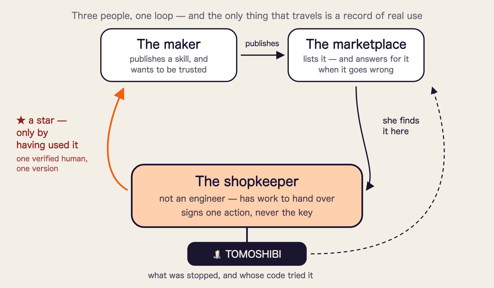

# Finalist pitch — the 3-minute slide skeleton (2026-11-06)

> **Five slides. The middle of the talk has no slide at all, because the product is running.**
> The 4-minute running order with every spoken line is in `2026-11-07-finalist-4min.md`;
> this file is the structure and what each part is for. Built to land at **2:55**, so there is
> five seconds of slack and no race at the end.
>
> Judged on **Technicality / Originality / Practicality / Usability / WOW**.
> What we are told matters most is **showing a working system**, so the live run is the spine and
> the slides only hold what a live screen cannot say.

---

## The shape

| | Time | What is on screen | What it is for |
|---|---|---|---|
| **S1** | 0:00–0:25 | **The problem.** One picture, three short lines | Everyone in the room has done this |
| **S2** | 0:25–0:50 | **Before / after**, as one picture | They can see the change before it is explained |
| **— live —** | **0:50–2:10** | **No slide. The product** | Technicality · WOW · Usability |
| **S3** | 2:10–2:28 | **What it gives, and what produces it** | Ties what they just watched to why they should care |
| **S4** | 2:28–2:40 | **Who it is for, and what changes for them** | Practicality |
| **S5** | 2:40–2:55 | **What it is for, and who built it** | The last thing they look at while deciding |

**Total 2:55.** The press lands at ~1:20. If they cut you off any time after it, the point is out.

---

## S1 — The problem (0:00–0:25)

**On the slide:** a key taped to a robot hand — and **behind it, a dozen more.** Three short lines under it.

> **No limit. No expiry. No receipt.**

**Said:** *"I suspect there are people in this room who pasted an API key into an AI agent this
week. Maybe this morning. That key has no spending limit, it never expires, and it produces no
receipt. We would never hand a credit card over like that.*
>
> *And it is never just one. Every agent, every skill, every service wants its own. **The thing the
> AI era has quietly handed us to manage is not prompts, and not models. It is keys** — more of
> them, in more places, held by more software than any of us is actually keeping track of."*

**Do not put the product name on this slide.** The first twenty-five seconds belong to the problem.

---

## S2 — Before and after (0:25–0:50)

**One picture, split down the middle. This slide carries the claim, so it must read in two seconds.**

| **Without TOMOSHIBI** | **With TOMOSHIBI** |
|---|---|
| The key is **in the agent's hand** | The key is **behind a gate**; the agent holds only a label |
| Every arrow goes through | Most go through · one waits for a finger · one is struck out |
| Underneath: *no limit · no expiry · no record* | Underneath: *scope · count · expiry · a record of both* |

**Beneath the whole slide, the name and one sentence:**

> **TOMOSHIBI — the approval layer that keeps the key and gives the agent one approved action at a time.**
>
> **The key is never handed over** → *there is no key anywhere for anything to leak from*
> **It asks only when it matters** → *it stays out of the way, so it does not get switched off*
> **Every refusal is kept, with who tried** → *"it was being used and I had no idea" stops being possible*
>
> ### So you can hand the work over and still have nothing happen that you cannot recover from.

**Said:** *"We keep the key. The agent gets one approved action at a time, and the approval is
signed on hardware it cannot press. Here it is running."*

---

## The live run (0:50–2:10) — **no slide**

Four beats, biggest first. Each one is a different thing the system does, not a step of a procedure.

| | ~ | What they see | The one sentence |
|---|---:|---|---|
| **1 Heavy → press** | 35 s | `0G: significant` → the real device rewrites itself, four lines → **a long press** → it goes through **once** | *"Routine reads pass silently and the agent never sees the key. But this one moves money, so it asks. An agent can tap a hundred times a second. **This is the one button it cannot press.**"* |
| **2 Refused** | 20 s | An out-of-scope request → `DENIED`, recorded **with the skill's own signature** | *"It stopped before it ran, and it has a name on it."* |
| **3 The flame** — **World** | 15 s | Bump the version → every star goes out at once | *"A star here is a fact, not a promise: a verified human who actually used this version. Change the version and they all go out."* |
| **4 The trail** — **0G** | 10 s | The record, and the transaction on 0G Storage | *"Allowed and refused sit in the same record, and it is on-chain."* |

**The silent routine case is spoken, not demonstrated** — it is the first clause of beat 1.
Showing it costs ten seconds and it is the least surprising thing the system does.

**If the device misbehaves:** go on talking and show the same press on screen; the fallback ladder
is in `2026-11-06-storyboard.md` §"Order of degradation". **Never stop to fix hardware on stage.**

---

## S3 — What it gives, and what produces it (2:10–2:28)

**Four rows. The left column is the only part they need to read; the right is there so the room can
see that each one is a mechanism, not a promise.**

| What the person gets | What produces it |
|---|---|
| **There is no key inside the agent to steal** | The secret is put in at the moment of sending. The agent only ever holds a label, so there is nothing in its context, its logs or its skills to take |
| **A payment you did not press does not happen** | A **0G** sealed model weighs each request first, and only the heavy ones are sent to a **Ledger** for a long press. It rarely asks — which is why it does not get switched off |
| **"It was being used and I had no idea" stops being possible** | An append-only trail, one line per use, and an out-of-scope attempt is kept **with the signature of whatever tried it** |
| **When choosing a tool, you can see praise that cannot be bought** | A **World ID**-verified person, who actually used **that exact version**, is the only one who can light a star — and they all go out when the version changes |

**Said:** *"Four things, and each one is something running rather than something promised."*

---

## S4 — Who it is for, and what changes for them (2:28–2:40)

**On the slide: one picture — [`assets/trust-loop.png`](../assets/trust-loop.png). Three people, one loop.**

The shopkeeper is the protagonist; the other two are why her choice is not guesswork.
**The maker** publishes and wants to be trusted. **The marketplace** lists it and has to answer for
it. **She** lights a star only by having actually used it — so what travels around the loop is a
record of real use, and nothing else.

| | What changes for them |
|---|---|
| **A shopkeeper who is not an engineer** | She can hand work to an agent **without holding something she has no way to manage** |
| **Someone publishing a skill** | Her reputation is built from **actual use**, not from a star count anyone can buy |
| **A marketplace** | When a stray skill does something, they can **say what was stopped and whose code tried it** — instead of closing the market |

**In small type at the foot of the slide, not spoken unless asked:**

> Metered judgement and flame display. **No percentage of the money that moved** — so we are never
> a company that loses money the more it stops.

**Said:** *"None of this is a key-management tool. It is the layer that makes handing work to an
agent something an ordinary person can afford to do."*

---

## S5 — What it is for, and who built it (2:40–2:55)

**On the slide: one line, large, on ink. Under it, the team.**

> # Hand over the work. Not the key.
>
> **So that trusting an agent with something real is a thing an ordinary person can afford to do.**

**Underneath, three short lines — the value, not the features:**

> **Nothing to memorise, store or manage. It cannot go past what you signed. And whatever happens,
> you can explain it afterwards.**

**And the team, on the same slide:**

> ### Team Yohaku (余白)
> **minta** — the device and everything a person actually looks at
> **kou** — the broker, and the three technologies underneath it
>
> *Two people, thirty-six hours, one working system.*

**Said:** *"We built this because managing API keys for agents got away from us — one per agent,
one per skill, one per service, and no way to see what any of them had done. Hand over the work.
Not the key."*

**The line "a review score never expires, a flame goes out" is now the answer to "what inspired
you" in Q&A** (`2026-11-07-finalist-4min.md` §3), not the closing slide. On its own it needs
explaining, and a closing line that needs explaining is not a closing line.

---

## Where each criterion is earned

| | Where |
|---|---|
| **Technicality** | The press on real hardware, and `DENIED` carrying the skill's signature |
| **Originality** | Four distinct refusals, never collapsed — and stars that go out |
| **Practicality** | S4: three named people, and the fact that it is running |
| **Usability** | The spoken routine line, and the first row of S3: on an ordinary day it asks nothing |
| **WOW** | The flame beat: every star going out at once |

---

## What is deliberately not in the three minutes

Say these only if asked. Each has a ready answer in `2026-11-07-finalist-4min.md` §3.

- **`STOPPED`** — what happens when the sealed model cannot be reached (almost always asked)
- **Where the key actually lives**, and that a local Broker is a demo convenience → `ideation/2026-11-06-where-the-key-lives.md`
- **The architecture diagram** — one spoken sentence beats a slide: *"who knows what is separated by design"*
- **x402 and why budget control is left to the implementation**
